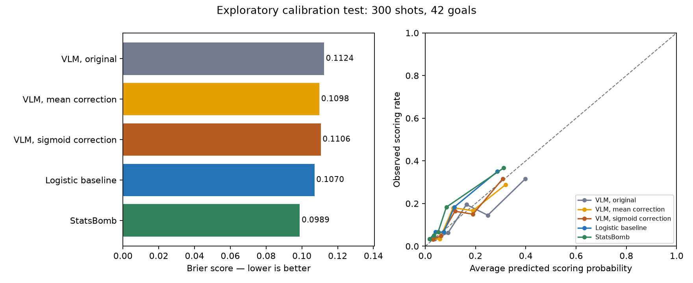

# Luna calibration experiment — simple report

Completed October 15, 2026.

**Both calibration methods reduced Luna's probability error on this test. Neither beat the logistic baseline.**

Tested **300 image-only shots, 42 goals, across 63 matches**. The actual scoring rate was 14.0%.

| Method | Brier — lower is better | AUC — higher is better | Average predicted scoring rate |
|---|---:|---:|---:|
| VLM, original | 0.1124 | 0.728 | 18.1% |
| VLM, mean correction | 0.1098 | 0.723 | 14.0% |
| VLM, sigmoid correction | 0.1106 | 0.719 | 14.0% |
| Logistic baseline | 0.1070 | 0.762 | 10.7% |
| StatsBomb | 0.0989 | 0.793 | 10.0% |

What was tested:

- Expanded the image-only Luna run from 50 to 300 shots, reusing saved predictions.
- Tried a simple correction to its overall scoring level and a two-parameter sigmoid correction.
- For every tested match, learned the correction using other matches only.
- Kept the original 50-shot files in `results/calibration_experiment/before_expansion/`.
- All 14 offline software checks passed.

How certain are these results?

- Mean correction minus original Brier: -0.0026; approximate 95% match-bootstrap interval [-0.0074, +0.0025]. This includes no improvement.
- Sigmoid correction minus original Brier: -0.0018; approximate 95% match-bootstrap interval [-0.0072, +0.0038]. This includes no improvement.

The earlier body-part experiment used only 50 shots, so keep it separate:

- Image-only Luna Brier: 0.1276.
- Body-part Luna Brier: 0.1204.
- Body-part Luna after mean correction: 0.1202.
- Logistic baseline on those same 50 shots: 0.1155.

Important limits:

- These are exploratory World Cup cross-validation results, not validation on a new competition.
- Confidence intervals resample matches but do not refit the correction in every bootstrap sample.
- The logistic baseline receives the header/body-part feature; the image-only VLM does not. This is not an equal-input comparison.
- More evaluated shots did not train Luna. Calibration is a separate supervised correction, not fine-tuning.
- Calibration changes the probability scale; it does not teach the VLM to interpret the pitch diagram better.

Brier measures probability error. AUC measures how well chances are ranked. Average predicted scoring rate checks the overall scoring level and is not an accuracy score. The corrections use different fitted parameters for each held-out fold, so pooled AUC can change without improving the model's underlying ranking.

Next experiment: check whether Luna reads the geometry correctly. Compare its estimates of distance, angle, and goalkeeper position with the known coordinates before investing in fine-tuning.
