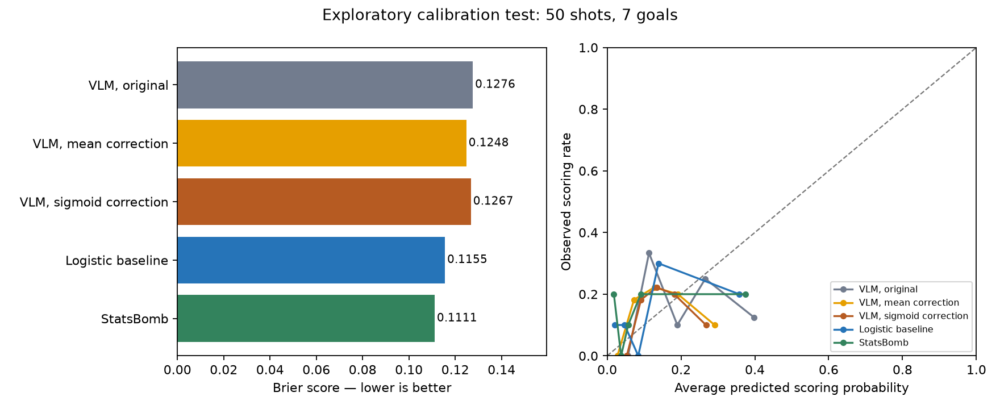

# Calibration test report

Input: `results/gpt_6_luna/shots.csv`

**50 shots; 7 goals; 35 matches.** Observed scoring rate: 14.0%.

## What happened

- Original VLM Brier: **0.1276**.
- Mean correction Brier: **0.1248** (better than original).
- Sigmoid correction Brier: **0.1267** (better than original).
- Logistic baseline Brier: **0.1155**. The sigmoid-corrected VLM was **worse by point estimate**.
- Sigmoid minus original Brier difference: **-0.0008**; approximate 95% match-bootstrap interval **[-0.0161, +0.0171]**. Negative favors calibration.

## Scores

| Model | Brier (lower better) | AUC | Mean xG | Log loss |
|---|---:|---:|---:|---:|
| VLM, original | 0.1276 | 0.610 | 19.5% | 0.4069 |
| VLM, mean correction | 0.1248 | 0.601 | 14.1% | 0.4037 |
| VLM, sigmoid correction | 0.1267 | 0.581 | 14.5% | 0.4110 |
| Logistic baseline | 0.1155 | 0.674 | 13.0% | 0.3910 |
| StatsBomb | 0.1111 | 0.601 | 11.6% | 0.4220 |
| Training goal-rate reference | 0.1215 | 0.405 | 14.0% | 0.4095 |

## How it was tested

- 5-fold cross-validation, grouping whole matches and using fixed seed 7 by default.
- Each correction was fitted only on the other folds, with no goals from the tested matches.
- Mean correction fits one intercept on log odds. Sigmoid correction fits an intercept and a nonnegative slope, with fixed weak shrinkage toward slope 1.
- Both methods were fixed before evaluating results; there was no search for the best settings.
- Baselines are the existing saved predictions, rather than newly fitted models.
- The training-rate reference predicts the goal rate of the other folds; it does not use the tested matches' outcomes.
- Bootstrap resamples whole matches. Its intervals condition on the fitted cross-validation predictions and do not include refitting uncertainty.

## Limits

- This is an exploratory cross-validation result, not validation on a new competition.
- With few goals, fitted corrections and score differences can be unstable. Independent matches are needed to confirm any improvement.
- Calibration is monotonic within each fold. Pooled AUC may change because different folds use different corrections; this does not demonstrate improved within-model ranking.
- Calibrated predictions include a supervised training step and should be reported separately from zero-shot results.

