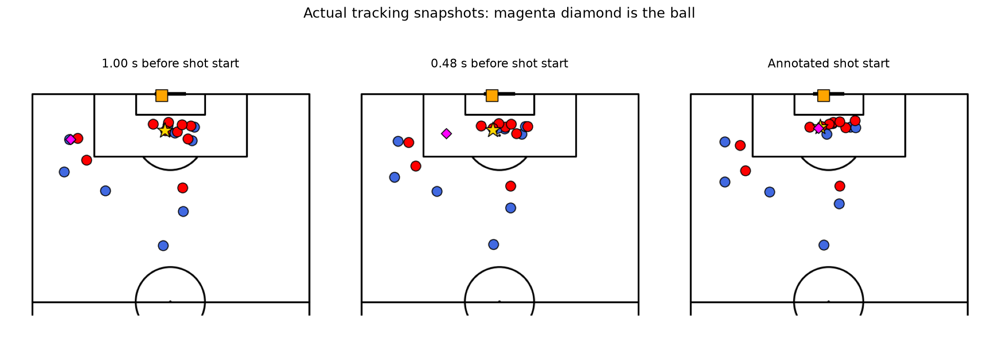
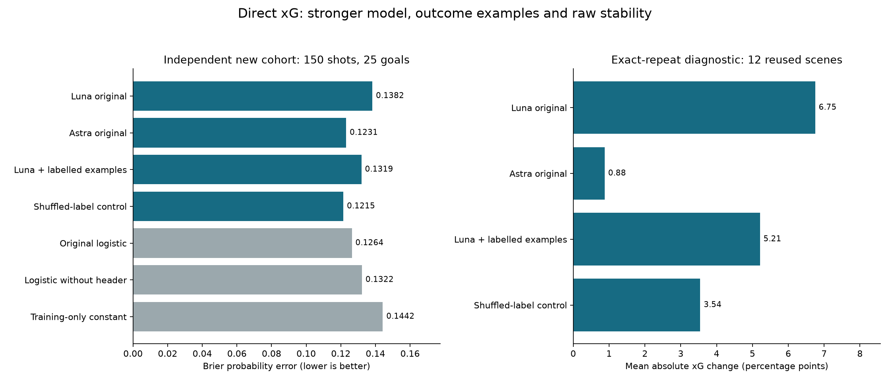

# Core-fix experiments: raw visual xG

29 October 2026 — America/Los_Angeles

**The fixed independent test supports lower raw Brier error than original Luna for Astra (zero-shot). Baseline superiority, ranking, negative controls and consistency are reported separately; a Brier gain alone is not a complete core fix.**

Completed **945 generation calls**. New usage estimate **$2.563744**, conservative **$2.971702**, below the **$4** round cap. All reported VLM predictions are raw API answers. No paid runner remains active.

## Findings in plain language

- **Astra is the strongest supported change.** Raw Brier fell from 0.1382 to 0.1231, an 11.0% reduction. The prespecified 99% paired match interval versus Luna excludes zero. AUC rose from 0.640 to 0.721, and observed repeat variation fell from 6.75 to 0.88 percentage points. The latter diagnostics are small and descriptive.
- **The gain is not explained by matching the overall average.** Original Luna already averaged 16.9% versus 16.7% actual goals; Astra averaged 14.9%, yet had better Brier and ranking. Its 6–18-unit Brier also fell from 0.1682 to 0.1449.
- **A logistic win is not established.** Astra's 0.1231 is below the original logistic point estimate 0.1264, but their 99% interval spans zero. This does not establish equivalence either.
- **The 48 correct outcome examples are not a validated fix.** They did not establish an advantage over original Luna or the shuffled-label control. The shuffled control scored better by point estimate, so selecting it as a successful learned method would be misleading. Correct image/outcome learning has not been demonstrated.
- **Past tracking worsened this Luna pilot.** History Brier 0.1363 versus matched single-frame 0.1037; ranking and repeat stability were also weaker. The current-frame-plus-ball condition is a possible separate lead, but its comparison with the original also changes the prompt, and two games cannot establish a solution.

## What changed and why

- **Stronger zero-shot model:** original image-only prompt and image, comparing GPT-6 Astra low against GPT-6 Luna low. No target probabilities or query metadata.
- **Task-specific visual examples:** Luna sees 48 fixed historical World Cup shot images with their observed goal/no-goal outcomes. This is a separate few-shot condition, not zero-shot or weight fine-tuning. Single outcomes are explicitly described as noisy rather than true xG 0/1.
- **Shuffled-label negative control:** exactly the same historical images and positive-label count, but labels permuted with a fixed seed. This distinguishes image/outcome association from generic example-frequency conditioning.
- **Additional temporal information:** actual Metrica tracking snapshots at 1.00 and 0.48 seconds before the provider shot-start frame, plus that frame. A matched single-frame condition includes the identical final image and tracked-ball marker. No future frames or invented body pose.
- **Stability and visual behavior:** new exact repeats on 12 fixed development scenes and 12 fixed synthetic favorable/base pairs, with no probability averaging or monotonicity enforcement.

The 48 natural random training examples contain **4 goals**. Their group IDs are disjoint from the new query matches. Earlier worked-example studies supplied four geometry examples with no outcomes; the current outcome-learning and label-permutation experiments are new. No example xG estimates, query coordinates, baseline predictions or selected target rate are supplied.

## New match-group test

The source pool was frozen at 200 natural-sample shots from 34 previously unused La Liga 2016/17 match groups, excluding all 488 prior recorded StatsBomb groups. A 12-shot ×4-condition reused-AFCON pilot measured validity and usage only. The prespecified resource rule selected **150** shots, before any accuracy scoring: projected conservative totals for 200/150/100 were $4.795, $3.882, $2.970. The chosen cohort is the exact prefix of the reserved random ordering. No result-driven sampling or method selection.

Actual evaluation: **150 shots, 25 goals (16.7%), 34 matches**. All four arms use new calls and randomized within-shot order.

| Method | Brier ↓ | AUC ↑ | Log loss ↓ | Mean xG |
|---|---:|---:|---:|---:|
| Original Luna (zero-shot) | 0.138221 | 0.640 | 0.447929 | 16.9% |
| Astra (zero-shot) | 0.123072 | 0.721 | 0.408431 | 14.9% |
| Luna + correct outcome examples | 0.131891 | 0.655 | 0.428472 | 16.5% |
| Luna + shuffled labels (control) | 0.121466 | 0.746 | 0.396753 | 16.2% |
| Original logistic (4 inputs) | 0.126371 | 0.744 | 0.411857 | 10.0% |
| Original logistic without header | 0.132211 | 0.724 | 0.430340 | 9.2% |
| StatsBomb reference | 0.119381 | 0.781 | 0.395754 | 11.0% |
| WC training-only constant | 0.144235 | 0.500 | 0.476729 | 9.4% |
| Example-frequency constant | 0.145833 | 0.500 | 0.486661 | 8.3% |

Five prespecified paired Brier comparisons use 99% whole-match bootstrap intervals (10,000 resamples), correcting within this study for five primary comparisons. Negative favors the first method. This exploratory program also contains earlier studies; these intervals do not adjust for every historical comparison.

| Comparison | Brier difference | 99% match interval |
|---|---:|---|
| Astra (zero-shot) minus Original Luna (zero-shot) | -0.015150 | [-0.027544, -0.002236] |
| Astra (zero-shot) minus Original logistic (4 inputs) | -0.003299 | [-0.019142, +0.009652] |
| Luna + correct outcome examples minus Original Luna (zero-shot) | -0.006330 | [-0.021448, +0.010302] |
| Luna + correct outcome examples minus Original logistic (4 inputs) | +0.005521 | [-0.011322, +0.020601] |
| Luna + correct outcome examples minus Luna + shuffled labels (control) | +0.010425 | [-0.003669, +0.026516] |

Intervals crossing zero establish neither superiority nor equivalence. The original logistic uses a header flag absent from query images; its no-header version is separate, not a silently weakened replacement. Both use recorded positions and remain frozen on 3,068 World Cup shots. StatsBomb is another estimate rather than ground-truth shot probability.

## Does a candidate address the core errors?

The prespecified short-range diagnostic contains 78 shots and 16 goals in the 6–18 normalized-unit band. These are normalized pitch coordinates, not verified metres/yards. Subgroup results are descriptive, with no independent subgroup-success claim.

| Method | Brier ↓ | AUC ↑ | Log loss ↓ | Mean xG |
|---|---:|---:|---:|---:|
| Original Luna (zero-shot) | 0.168177 | 0.586 | 0.512456 | 24.5% |
| Astra (zero-shot) | 0.144885 | 0.714 | 0.455301 | 21.5% |
| Luna + correct outcome examples | 0.157733 | 0.597 | 0.493540 | 22.1% |
| Luna + shuffled labels (control) | 0.140432 | 0.783 | 0.445515 | 21.8% |
| Original logistic (4 inputs) | 0.149927 | 0.730 | 0.470283 | 14.3% |
| Original logistic without header | 0.159579 | 0.663 | 0.499838 | 12.6% |
| StatsBomb reference | 0.137748 | 0.729 | 0.442419 | 15.8% |
| WC training-only constant | 0.175501 | 0.500 | 0.564079 | 9.4% |
| Example-frequency constant | 0.177885 | 0.500 | 0.578887 | 8.3% |

Correct-versus-shuffled examples are the key learning control. A lower Brier than original Luna accompanied by a similar shuffled-label gain would not establish that the model learned useful image/outcome associations. The training-prior and example-frequency constants are separate uninformative references; neither is applied to any VLM output. Ranking, short-range performance and consistency also matter.

| Method | Mean absolute exact-repeat change | Expected visual direction |
|---|---:|---:|
| Original Luna (zero-shot) | 6.75 percentage points | 9/12 |
| Astra (zero-shot) | 0.88 percentage points | 10/12 |
| Luna + correct outcome examples | 5.21 percentage points | 7/12 |
| Luna + shuffled labels (control) | 3.54 percentage points | 7/12 |

Exact repeats compare individual raw outputs to the corresponding initial pilot response. Their average absolute differences are diagnostic summaries, not averaged predictions used for accuracy. The 12 synthetic templates share structure; angle changes also alter the keeper’s relationship to the shooting line. They provide qualitative checks rather than independent football outcomes or exact probability targets. Every tie and reversal is preserved in consistency.json.

## Does past tracking context help?

43 previously used Metrica shots, 6 goals, 2 anonymized games. Three source cases lacked some required past actor/ball tracking and were excluded before any call, without inspecting outcomes or errors. All eligible cases were retained. This reused two-game pilot is descriptive, not new independent confirmation.

| Method | Brier ↓ | AUC ↑ | Log loss ↓ | Mean xG |
|---|---:|---:|---:|---:|
| Original single snapshot | 0.113791 | 0.687 | 0.372043 | 17.3% |
| Matched current frame + ball | 0.103686 | 0.775 | 0.342146 | 17.8% |
| Past snapshots + same current frame | 0.136284 | 0.658 | 0.432399 | 20.2% |
| Original logistic (4 inputs) | 0.106469 | 0.770 | 0.354655 | 9.5% |
| Original logistic without header | 0.109511 | 0.730 | 0.365021 | 10.9% |

History minus matched single-frame Brier: **+0.032598**. The same generic motion prompt is used for both matched conditions. Last-frame pixels are identical. Original single-snapshot prompting is shown as a separate reference.

Matched current frame + ball: mean absolute repeat change 7.33 points over 12 cases.
Past snapshots + same current frame: mean absolute repeat change 10.54 points over 12 cases.

These are 2-D tracking renders, not actual broadcast frames or body pose. The original field normalization is approximate across providers, and event timing is the provider annotation rather than independently verified physical contact. All selected frames are at/before the annotated shot start. End frame/coordinates, outcome tags, identities and clocks do not enter images. Ball height, detailed pose and richer physical execution remain missing. The user had no authorized local footage; xGHub access restrictions were respected.

## Integrity, cost and limits

All **36** final audit checks passed, plus four offline control tests: source/model/input hashes, correct training labels, fixed negative control, query-group exclusion, source frames, resource-choice reproduction, exact reconstructed requests, raw answers, model identity/settings/usage, concurrent reservations and private exact-credential exposure. No hidden retries, dropped failures, result-driven replacements, post-hoc probability correction, statistical VLM head, blends or enforced output consistency.

| Model | Calls | Input tokens | Cached input | Output including reasoning | Estimated cost |
|---|---:|---:|---:|---:|---:|
| gpt-6-luna | 747 | 6043673 | 483568 | 149636 | $0.635664 |
| gpt-6-astra | 198 | 85338 | 0 | 21494 | $1.928080 |

New round estimate $2.563744; conservative $2.971702, capped at $4. Known older partial conservative records total $1.4552639. Complete bills and other account activity are unavailable, so no live remaining balance is claimed. Gemini/Claude incur no new charges. Published standard prices were verified before inference, and full output cost plus input safety allowances were reserved before every request. In-flight reservations are allowed to reconcile before testing another reservation; the cap is never raised automatically.

The requested models are aliases, with returned identifiers and UTC request times preserved. Pretraining exposure is unknown. Match intervals condition on these predictions and fitted references, not all training or model-call uncertainty. The main cohort is modest and its size was set by resource usage; any favorable finding needs independent replication. No fine-tuning was performed.

All 34 reserved new match groups are now used and should be excluded from future untouched-data claims (522 recorded groups total). The Metrica games, old AFCON pilot and synthetic probes remain explicitly reused diagnostics.

Sources: [Astra settings/rates](https://developers.openai.com/api/docs/models/gpt-6-astra), [Luna settings/rates](https://developers.openai.com/api/docs/models/gpt-6-luna), [StatsBomb Open Data](https://github.com/hudl/open-data), [Metrica tracking data](https://github.com/metrica-sports/sample-data).
