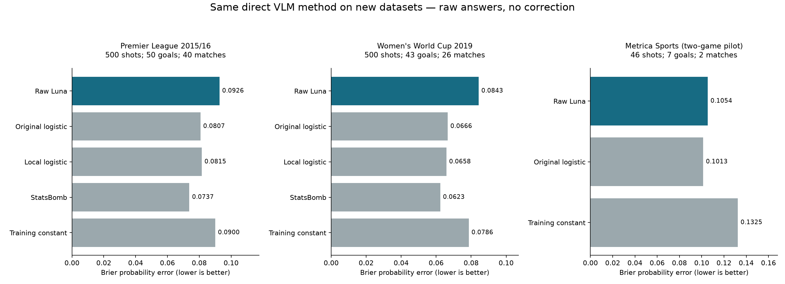

# Direct visual xG on different datasets

29 October 2026 — America/Los_Angeles

**Changing datasets did not solve raw probability accuracy: original Luna has higher Brier error than the original frozen logistic reference in both larger cohorts under the prespecified intervals.**

Completed **1046 new generation calls**, estimated **$0.204948** (conservative **$0.216219**), below the **$1** incremental cap. All probabilities are raw original GPT-6 Luna answers. No paid runner remains active.

## What changed

Only the evaluation data changed. The VLM kept the original zero-shot prompt, original half-pitch renderer, low effort, high image detail and 4,096-token maximum. The later missing-information prompt was not adopted. No numerical coordinates, goal rates, outcomes, body-part flags, cohort identity or baseline predictions entered VLM requests. No recalibration, probability head, baseline blend, repeat average or fine-tuning.

Metrica is a separate provider with synchronized tracking/event data. Premier League and Women’s World Cup are new populations within StatsBomb, not independent providers. They are reported separately, with no pooling to hide a failed cohort.

Two prespecified primary comparisons test original Luna minus the original frozen World Cup four-feature logistic Brier in the larger cohorts, using 97.5% whole-match bootstrap intervals (10,000 resamples) for two comparisons. Negative favors Luna. Metrica is descriptive only because it has two games. This continuation belongs to a broader exploratory program; the intervals do not adjust for every earlier study family.

Lower Brier/log loss means better probability estimates. Higher AUC means better shot ranking. A lower raw Brier on a different dataset is not automatically a model improvement, since goal rates and chance distributions differ.

## Premier League 2015/16

500 eligible shots, 50 goals (10.0%), 40 evaluated matches.

| Method | Brier ↓ | AUC ↑ | Log loss ↓ | Mean xG |
|---|---:|---:|---:|---:|
| Raw original Luna | 0.09265 | 0.711 | 0.31991 | 16.4% |
| Original WC-trained logistic (4 features) | 0.08072 | 0.737 | 0.29120 | 9.7% |
| Original WC logistic without header | 0.08258 | 0.711 | 0.29977 | 9.4% |
| Same-dataset logistic (4 features) | 0.08154 | 0.726 | 0.29658 | 10.2% |
| Same-dataset logistic without header | 0.08324 | 0.711 | 0.30348 | 10.0% |
| StatsBomb reference | 0.07374 | 0.790 | 0.26459 | 10.0% |
| Training-only constant | 0.09001 | 0.500 | 0.32513 | 9.7% |

Mean Luna xG minus observed goal rate: **+6.4%**. Mean alone does not establish individual prediction accuracy.

**Primary:** Luna minus original logistic Brier **+0.01193**, 97.5% whole-match interval **[+0.00374, +0.02010]**.

This interval supports a higher Brier for Luna in this cohort.

Secondary comparisons (95% intervals, not substitutes for the primary comparison):

- Luna minus Same-dataset logistic (4 features): +0.01111, [+0.00428, +0.01770].
- Luna minus Original WC logistic without header: +0.01007, [+0.00242, +0.01748].

The extra local statistical models were fitted on 990 shots (96 goals) from 40 disjoint matches, with the same fixed logistic fitting recipe and no outcome-driven tuning. The training-only constant uses only those training outcomes. These models are comparators; nothing supplies or corrects a VLM answer.

## Women's World Cup 2019

500 eligible shots, 43 goals (8.6%), 26 evaluated matches.

| Method | Brier ↓ | AUC ↑ | Log loss ↓ | Mean xG |
|---|---:|---:|---:|---:|
| Raw original Luna | 0.08427 | 0.745 | 0.30304 | 17.3% |
| Original WC-trained logistic (4 features) | 0.06655 | 0.788 | 0.24645 | 10.3% |
| Original WC logistic without header | 0.06794 | 0.769 | 0.25409 | 10.0% |
| Same-dataset logistic (4 features) | 0.06583 | 0.780 | 0.25639 | 10.4% |
| Same-dataset logistic without header | 0.06694 | 0.767 | 0.26265 | 10.1% |
| StatsBomb reference | 0.06230 | 0.845 | 0.23014 | 9.7% |
| Training-only constant | 0.07862 | 0.500 | 0.29326 | 8.9% |

Mean Luna xG minus observed goal rate: **+8.7%**. Mean alone does not establish individual prediction accuracy.

**Primary:** Luna minus original logistic Brier **+0.01772**, 97.5% whole-match interval **[+0.00832, +0.02579]**.

This interval supports a higher Brier for Luna in this cohort.

Secondary comparisons (95% intervals, not substitutes for the primary comparison):

- Luna minus Same-dataset logistic (4 features): +0.01844, [+0.01051, +0.02563].
- Luna minus Original WC logistic without header: +0.01633, [+0.00840, +0.02324].

The extra local statistical models were fitted on 626 shots (56 goals) from 26 disjoint matches, with the same fixed logistic fitting recipe and no outcome-driven tuning. The training-only constant uses only those training outcomes. These models are comparators; nothing supplies or corrects a VLM answer.

## Metrica Sports (two-game pilot)

46 eligible shots, 7 goals (15.2%), 2 evaluated matches.

| Method | Brier ↓ | AUC ↑ | Log loss ↓ | Mean xG |
|---|---:|---:|---:|---:|
| Raw original Luna | 0.10544 | 0.804 | 0.34364 | 18.2% |
| Original WC-trained logistic (4 features) | 0.10130 | 0.810 | 0.33982 | 10.5% |
| Original WC logistic without header | 0.10601 | 0.777 | 0.35368 | 11.6% |
| Training-only constant | 0.13245 | 0.500 | 0.44381 | 9.4% |

Mean Luna xG minus observed goal rate: **+3.0%**. Mean alone does not establish individual prediction accuracy.

Descriptive Luna-minus-original-logistic Brier: **+0.00414**. Two anonymized games cannot support a trustworthy population-level interval or superiority/equivalence claim. The constant uses the original World Cup training goal rate (287/3068).

The two source files contain 48 shot events. One annotated penalty and one shot without synchronized shooter tracking were excluded. All 46 remaining shots were retained. Goalkeeper roles were inferred from opening tracking before any shot, then held consistent across halves. An offline test caught a single-frame half-time mislabel before inference; corrected images are in metrica_v2. Initial failed-preflight images were retained and never submitted.

## Source integrity and fair comparisons

For StatsBomb, whole match groups were split before event downloads. Premier League uses 40 test and 40 training matches; Women’s World Cup uses 26 test and 26 training matches. Exactly 500 eligible test shots per cohort were randomly sampled without goal balancing or prior-error selection. All 356 previously recorded match groups were excluded. No partial-cohort scores were inspected and no result-driven samples were added. All 132 newly downloaded match groups are now used and must be excluded from future untouched-data claims.

The original logistic model is unchanged, fitted on 3,068 World Cup 2018/2022 shots. Four-feature models know distance, angle, header and opponent count in the shooting cone. The header flag supplies information absent from the image. Three-feature no-header references are therefore shown separately and never silently replace the original comparator. All numerical references also receive recorded coordinates. StatsBomb xG is another estimate, not ground-truth shot probability.

The unchanged generic VLM is not told which images come from women’s football; this is an explicit transfer limitation. Its source population may differ from the implicit professional-football prior. The extra local statistical references are fitted to each population, and therefore have population-specific training information.

Metrica uses the event Start Frame only. End coordinates, end frames, outcome tags, names and clocks are not rendered. Tracking positions on the provider’s 105-by-68-metre field are linearly normalized to the existing 120-by-80 diagram conventions and rotated for attacking direction. This shared coordinate representation is approximate rather than a new metric-geometry benchmark. Goalkeeper roles are inferred, not certified by a provider role label. Anonymized matches prevent ruling out cross-provider identity overlap. Pretraining exposure is unknown for every source.

Binary goal outcomes are noisy. Match-bootstrap intervals condition on these fixed predictions and fitted references; they do not capture all model-call variability, provider measurement error or training uncertainty. No equivalence margin was prespecified. A favorable single dataset would still require independent replication.

The requested model is an API alias; returned model identifiers and UTC request times are preserved. Dataset coverage and source bytes are frozen in this study, while remote repositories may change later.

## Other datasets assessed

**xGHub:** the author release has shot clips, pose/orientation context and goal labels, making it relevant to information missing from position-only diagrams. The actual Hugging Face release requires institutional access and an NDA for restricted clips. The public GitHub repository contains the README and a sample animation, not the full footage. No access request, NDA acceptance, restricted download or outside message was made. It was not evaluated here. [Official release/access requirements](https://huggingface.co/datasets/mguti97/xGHub), [author repository](https://github.com/mguti97/xGHub).

SkillCorner and Wyscout were also reviewed as alternatives. They were not silently treated as the same input/target format or added after seeing scores.

## Cost and verification

New OpenAI usage estimate **$0.204948**; conservative **$0.216219**. Gemini and Claude **$0 new spending**. The prior round cost $0.3985504 estimated; older tracked records remain separately preserved. Complete account bills and live balances are unavailable, so these are usage estimates, not an account-wide remaining balance.

Input tokens: 450,826; output including reasoning: 319,731; reasoning tokens: 273,153. Six concurrent workers maximum. Every input preflight plus a safety allowance and every full next output allowance was reserved before dispatch, including concurrent requests. No hidden retries, difficult-shot replacement, discarded cohort or probability conversion.

All **30** final audit checks passed: immutable source/code/cohort/reference hashes, train/test separation, prior-match exclusion, exact request reconstruction, unchanged raw predictions, identity/settings/usage, reproduction of local reference predictions, budget and private exact-credential exposure. Four offline transfer checks passed after the documented Metrica preflight correction.

Artifacts: protocol.json and data_plan.json; data_amendment.json; per-cohort selection/baseline/provenance, predictions.csv and summary.json; raw response files; token counts and attempts ledger; audit.json; source files and original-renderer images. Initial preflight revisions are preserved separately.

Sources: [Metrica Sports sample data](https://github.com/metrica-sports/sample-data), [Hudl StatsBomb Open Data](https://github.com/hudl/open-data), [official Luna settings/rates](https://developers.openai.com/api/docs/models/gpt-6-luna).
