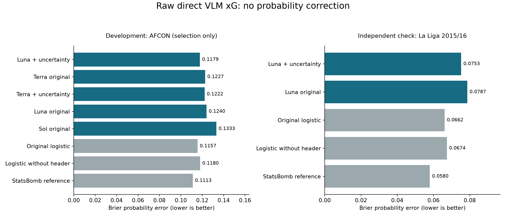

# Direct visual xG: new models and missing-information instructions

Date: 29 October 2026 (America/Los_Angeles).

**The independent test does not establish a reliable raw-VLM improvement over logistic regression. The interval crossing zero is inconclusive and does not establish equivalence.**

The model returns xG directly from the diagram. Every reported probability is its raw answer. No recalibration, trained prediction head, correction, averaging, numerical baseline input or target mean.

## Fixed development comparison

The 50 AFCON shots (6 goals, 15 matches) had already been used for development. Each of five settings received identical original image bytes, with new Luna controls. This is model selection, not untouched confirmation. All arms/prompts and the selection rule were frozen before new inference.

| Method | Brier ↓ | AUC ↑ | Log loss ↓ | Mean xG |
|---|---:|---:|---:|---:|
| luna_uncertainty | 0.117865 | 0.498 | 0.419004 | 13.9% |
| terra_original | 0.122723 | 0.428 | 0.445439 | 12.3% |
| terra_uncertainty | 0.122231 | 0.487 | 0.431796 | 12.7% |
| luna_original | 0.124032 | 0.557 | 0.411698 | 17.7% |
| sol_original | 0.133267 | 0.475 | 0.456877 | 16.8% |
| baseline_xg | 0.115685 | 0.553 | 0.426284 | 10.1% |
| baseline_image_xg | 0.118025 | 0.508 | 0.429434 | 10.0% |
| sb_xg | 0.111282 | 0.568 | 0.420289 | 10.4% |

Selected by the fixed lowest-Brier rule: **luna_uncertainty**. A development winner does not prove an improvement.

On development, the uncertainty instruction reduced Luna Brier error from 0.124032 to 0.117865, but AUC fell from 0.557 to 0.498 and log loss rose from 0.411698 to 0.419004. Thus the screening result does not show better shot ranking or visual interpretation. The changed mean alone is not success. Neither larger model won this fixed screen.

The uncertainty prompt asks the VLM to inspect geometry and account for unobserved body part, ball motion and execution. It supplies no numerical probability anchors, goal rates, examples, query coordinates or outcomes. It changes the instructions before prediction; nothing adjusts the output afterward.

Luna uses low effort, Terra medium, and Sol low. Those are complete method comparisons; differences between models are not isolated reasoning-effort effects. Every arm has high image detail and the same 4,096-token maximum.

## Independent confirmation

Fixed 200 shots, 16 goals, 40 matches. Source: La Liga 2015/16. Forty previously unused match groups were chosen before event downloads, then 200 eligible non-penalty freeze-frame shots were sampled without outcome stratification. The cohort and original renderer were fixed before screening. The selected method was frozen before confirmation inference or scoring.

| Method | Brier ↓ | AUC ↑ | Log loss ↓ | Mean xG |
|---|---:|---:|---:|---:|
| luna_uncertainty | 0.075293 | 0.764 | 0.269290 | 15.1% |
| luna_original | 0.078691 | 0.808 | 0.269534 | 16.3% |
| baseline_xg | 0.066201 | 0.805 | 0.235165 | 9.4% |
| baseline_image_xg | 0.067373 | 0.805 | 0.237531 | 9.6% |
| sb_xg | 0.057976 | 0.867 | 0.206950 | 8.9% |

Primary differences use 10,000 whole-match bootstrap resamples and conservative 97.5% intervals for the two planned comparisons. Negative favors the selected VLM.

- luna_uncertainty minus baseline_xg: **+0.009092**, interval **[-0.001002, +0.018361]**.
- luna_uncertainty minus luna_original: **-0.003397**, interval **[-0.014186, +0.007403]**.

Secondary comparisons (95% intervals; do not replace the primary test):

- Selected VLM minus baseline_image_xg: +0.007920, [-0.000017, +0.015810].
- Selected VLM minus sb_xg: +0.017317, [+0.007516, +0.026874].

## Why this does not resolve the core issue

The selected method averaged 15.1% xG against 8.0% observed goals. Its mean overprediction was 7.1% (post-hoc whole-match 95% interval 3.9% to 10.4%). Original Luna ranked chances at AUC 0.808, versus 0.764 for the new prompt. The small Brier change therefore does not demonstrate better visual interpretation.

A separate post-hoc reference that predicts the World Cup training goal rate (9.35%) for every shot scores Brier 0.073784, versus the VLM's 0.075293. The paired difference is inconclusive. This constant uses only the original 3,068 training shots (287 goals), supplies no visual information, and is never applied to or blended with a VLM output. Its role is to prevent a change in the overall probability level from being mistaken for solved image-based xG.

These explanatory checks were added after the complete independent results and are labelled post-hoc. They do not change the prespecified primary comparisons, selected model, predictions or sample. No tested change in this campaign is a confirmed fix.

## Fair comparison and limits

Original logistic uses distance, goal-opening angle, header and opponent count in the shooting cone. Its header flag supplies information absent from the diagram. The no-header logistic is separate, and does not replace or weaken the original comparator. Both logistic models receive recorded positions and were frozen on 3,068 World Cup 2018/2022 shots. New La Liga labels did not train either model. StatsBomb xG is a reference, not ground-truth probability.

The independent cohort comes from another competition and season. Public/pretraining exposure cannot be fully audited: unused means unused in our experimental records. This is a standardized-diagram benchmark, not a broadcast-video evaluation. Coordinates are normalized pitch units, not verified physical distances. Binary goal outcomes are noisy, and uncertainty conditions on these fitted baselines and predictions. Crossing zero does not prove equivalence; a lower average xG is not individual prediction accuracy.

Model IDs are aliases. Actual returned IDs, request settings, image/source hashes and timestamps are preserved. No test-set tuning, post-hoc sample extension, replacement shots or selectively omitted failed conditions.

## Spending and reproducibility

New successful generation calls: **650**. Usage-derived new OpenAI estimate: **$0.383967**. Conservative exposure **$0.412936**, below the **$3 combined** new-round ceiling. Gemini and Claude: **$0 new spending**, because credentials were unavailable. The prior direct campaign's conservative estimate was $0.1049749. Two additional older Luna usage tables account for $0.632989 estimated / $0.705679 conservative, recorded separately in prior_budget_context.json. These are partial historical records: other older experiments/account activity are not all bill-reconciled, and no live remaining balance is claimed.

| Model | Calls | Input tokens | Output/reasoning tokens | Estimated new cost |
|---|---:|---:|---:|---:|
| gpt-6-luna | 500 | 242250 | 171804 | $0.110127 |
| gpt-6.1-terra | 100 | 48550 | 22674 | $0.161920 |
| gpt-6.1-sol | 50 | 21550 | 6882 | $0.111920 |

Official input-token preflights plus a 1,024-token allowance and the full next 4,096-output-token charge were reserved before dispatch. The cap includes all concurrent requests (at most three). No SDK or hidden retry. Output/reasoning tokens are included in cost. Raw probabilities, including 0 or 1, are never clipped for Brier or saved predictions; log loss alone uses a numerical log convention at endpoints.

All **16** provenance, identity, request reconstruction, raw-answer, source, disjointness, budget and private exact-credential-exposure checks passed. Four offline guard tests also passed.

Artifacts: protocol.json; data/match_split.json and provenance.json; choice.json; each stage protocol/selection; token_counts.json; attempts.json; complete raw API responses; predictions.csv; summary.json; audit.json; original-byte images.

Sources: [StatsBomb Open Data](https://github.com/hudl/open-data), [Luna rates/settings](https://developers.openai.com/api/docs/models/gpt-6-luna), [Terra rates/settings](https://developers.openai.com/api/docs/models/gpt-6.1-terra), [Sol rates/settings](https://developers.openai.com/api/docs/models/gpt-6.1-sol).
