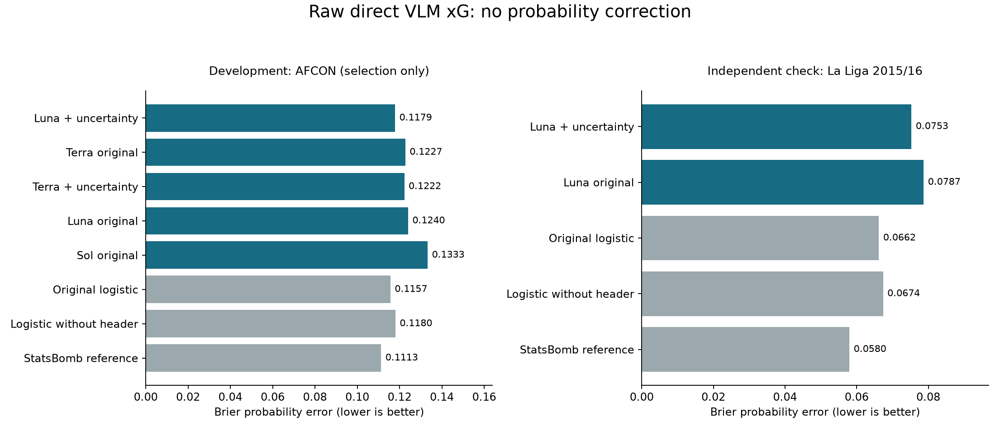

# Further visual xG experiments: 29 October 2026

**No tested change is a confirmed fix. We found useful failure evidence, not proof of accurate direct xG.**

Completed **722 new model calls**, estimated **$0.3986** in total. Conservative accounting **$0.4284**, below the **$3 combined** ceiling for this round. No paid runner remains active.

## What was tested

- **Models:** Luna low effort, Terra medium and Sol low, using identical original diagrams and the original prompt.
- **Missing-information instructions:** Luna and Terra were also asked to account for unknown body part, ball motion and execution. No numerical probability anchors or target scoring rate.
- **Independent accuracy check:** selected the best development method, froze it, then tested 200 naturally sampled shots (16 goals) from 40 new La Liga 2015/16 match groups. All 316 previously recorded match groups were excluded.
- **Controlled visual behavior:** 12 fixed synthetic cases covering distance, angle, keeper position and defensive blocking, with exact-repeat controls. This separate diagnostic was frozen before the independent accuracy results were scored.

Every xG value is the raw model answer. No recalibration, correction, statistical prediction head, baseline blending, output averaging or fine-tuning was used. The original logistic comparator is retained, including disclosure that its header flag is extra information absent from the image.

## Independent results

Lower Brier means lower probability error; higher AUC means better ranking. Compare methods on these same 200 shots, not scores across different cohorts.

| Method | Brier ↓ | AUC ↑ | Mean xG |
|---|---:|---:|---:|
| Luna with missing-information prompt | 0.0753 | 0.764 | 15.1% |
| Original Luna | 0.0787 | 0.808 | 16.3% |
| Original four-feature logistic | 0.0662 | 0.805 | 9.4% |
| Logistic without header | 0.0674 | 0.805 | 9.6% |
| StatsBomb reference | 0.0580 | 0.867 | 8.9% |

The new prompt reduced Brier from 0.0787 to 0.0753, but that improvement is inconclusive. Its ranking was weaker. The raw VLM probabilities still averaged 15.1% when 8% of shots scored.

Prespecified paired Brier differences, with 97.5% whole-match intervals for two primary comparisons:

- Selected Luna minus Original four-feature logistic: **+0.00909**, interval **[-0.00100, +0.01836]**.
- Selected Luna minus Original Luna: **-0.00340**, interval **[-0.01419, +0.00740]**.

Both intervals cross zero. They do not establish superiority or equivalence. StatsBomb remains a reference estimate rather than ground-truth shot probability.

A clearly labelled post-hoc check also compared the unchanged VLM against an uninformative constant learned only from World Cup training outcomes. The constant scored Brier 0.0738, versus 0.0753 for the selected VLM; the difference is inconclusive. It was never used to adjust a VLM answer. This check prevents a favorable overall probability level from being mistaken for a solved visual prediction problem.

## Did the model respond sensibly to changed pictures?

| Method | Expected direction | Mean absolute change on identical repeats |
|---|---:|---:|
| Original Luna | 10/12 | 6.3% |
| Luna with missing-information prompt | 7/12 | 12.8% |

The new prompt reversed the expected change on five cases, including all three defender-blocking cases. Original Luna had one tie and one reversal. These small synthetic examples are correlated and cannot establish football probability accuracy; angle changes also alter the keeper’s relationship to the shooting line, so qualitative expectations are not exact xG truth. Still, the diagnostic gives no reason to treat the new prompt as a robust solution. No symmetry/monotonicity constraints or repeat averages were imposed afterward.

## Spending, records and interpretation

New OpenAI estimate: **$0.398550**. New Gemini: **$0**. New Claude: **$0**. Only the OpenAI credential was configured. The known earlier direct campaign and two older usage tables are recorded separately; account-wide billing and remaining balances were not available. All new work stayed below the stricter $3 combined cap, with complete input/output reservations before each request and no hidden retries.

All raw requests were reconstructed and checked against their saved image/prompt hashes, model responses and usage. Source hashes, unused-match checks, unchanged probabilities, budget checks and private exact-credential scans passed. Four offline guard tests and the synthetic scene/repeat checks passed.

The observed evidence separates chance ranking from absolute probability accuracy. Original Luna has promising ranking on this cohort, but the tested methods do not establish accurate direct xG. Larger samples and other model/input hypotheses may help future research; this round is complete and has not silently adopted a probability correction.

[Full model-search methods, scores and audit](REPORT.md) · [Controlled visual diagnostic](../visual_counterfactuals_v1/REPORT.md)

