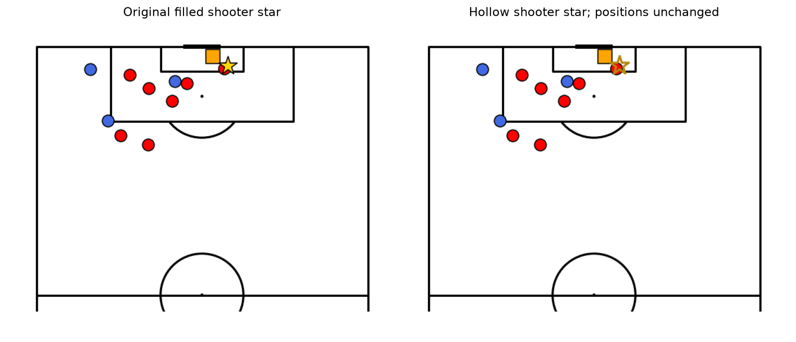
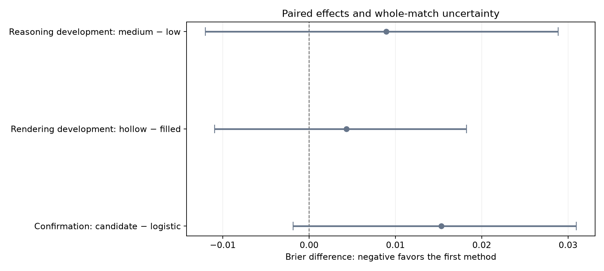

# Can Luna estimate xG directly from a shot image?

## Findings in plain English

**We did not establish that the chosen Luna method beats logistic regression. The independent confirmation result is inconclusive.**

The confirmation contains **150 shots, 14 goals and 36 matches**. The selected method uses **low reasoning and the standard diagram**. Its probabilities come directly from Luna, with no recalibration or statistical model changing the answers.

Its Brier score was **0.09798**, versus **0.08267** for logistic regression. Its AUC was **0.676**, versus **0.690** for logistic regression.

This conclusion applies to this model, frozen method and eligible AFCON sample. It is not a claim about every VLM or all football competitions.

**Estimated API spending: $0.1004**, including the earlier 12-shot pilot. The campaign working cap was **$2**, below the user's approximately **$10** limit. These are usage-based estimates at published Luna rates, not a billing statement or account-balance check.

## What was kept fixed

The research question stayed the same: give a general-purpose vision-language model an image of a shot and ask it to estimate the probability of a goal. The model received the image, a generic marker legend and the original zero-shot instructions. It did not receive the shot outcome, StatsBomb xG, the logistic prediction, numerical coordinates, body-part metadata or worked examples.

No probability correction, supervised prediction head, averaging, baseline blending or fine-tuning was used. Every reported VLM xG is the raw answer returned by GPT-6 Luna. The only candidate changes were reasoning effort and a small change to how the shooter marker was drawn.

All three reasoning settings received the same 4,096-token maximum in the new study. The earlier 12-shot pilot used 2,048; its results are kept separate. A larger allowance lets a model finish reasoning; it does not change an answer afterward.

## How to read the scores

- **Brier** measures probability error; lower is better. It is the primary measure.
- **AUC** measures how well high-quality chances rank above low-quality chances; higher is better. AUC of 0.5 means chance-level ranking.
- **Log loss** also measures probability error and penalizes confident mistakes; lower is better.
- **Mean predicted chance** only checks the overall level. Matching the observed goal rate does not establish good predictions for individual shots.
- **Uncertainty intervals** resample whole matches, keeping shots from a match together. An interval spanning zero cannot establish an improvement.

## 1. Did more reasoning help?

This was a fixed **50-shot development sample**, with **6 goals across 15 matches**, from previously unused AFCON 2023 match groups. Each image was sent once at low, medium and high reasoning effort, in randomized order.

| Method | Brier ↓ | AUC ↑ | Log loss ↓ | Mean predicted chance |
|---|---:|---:|---:|---:|
| Luna: medium reasoning | 0.13170 | 0.479 | 0.46900 | 17.3% |
| Luna: low reasoning | 0.12275 | 0.557 | 0.41619 | 15.4% |
| Luna: high reasoning | 0.13404 | 0.424 | 0.47624 | 15.4% |
| Logistic baseline (four inputs) | 0.11569 | 0.553 | 0.42628 | 10.1% |
| StatsBomb reference | 0.11128 | 0.568 | 0.42029 | 10.4% |
| Logistic without header input | 0.11803 | 0.508 | 0.42943 | 10.0% |

Prespecified medium-minus-low Brier comparison: +0.00896, with a 95.0% match-based interval [-0.01202, +0.02888]. The interval includes no improvement; the comparison is inconclusive. This does not prove equivalence.

The lowest development Brier selected **low reasoning**. High-effort comparisons and the selection itself are exploratory; the independent cohort checks whether a chosen benefit survives outside the selection sample.

The earlier 12-shot pilot looked favorable for medium reasoning, but had only two goals and one scored shot contributed about 62% of its net improvement. Its 22% relative Brier reduction was not a reliable baseline-win claim.

On the new 50-shot cohort, low and high effort had the same mean xG (15.42%) but different Brier scores and ranking. This illustrates why fixing only the average probability would not address all of the observed errors.

## 2. Did preventing marker overlap help?

On **40 World Cup development shots**, the shooter stayed at exactly the same position and marker size. We compared the original filled gold star with a hollow gold star. This can reveal nearby defender markers that an opaque star covers. All other players, pitch markings and instructions stayed unchanged.

This is a specific rendering intervention. It is not a rerun of the earlier numeric-grid, zoom, worked-example or role-separated-panel methods. These World Cup scenes have been studied before, so this comparison is exploratory.

| Method | Brier ↓ | AUC ↑ | Log loss ↓ | Mean predicted chance |
|---|---:|---:|---:|---:|
| Original filled shooter star | 0.08800 | 0.854 | 0.29902 | 14.8% |
| Hollow shooter star | 0.09232 | 0.831 | 0.30584 | 15.2% |
| Logistic baseline (four inputs) | 0.07820 | 0.857 | 0.26886 | 10.6% |
| StatsBomb reference | 0.07172 | 0.874 | 0.25667 | 11.0% |

Hollow-minus-filled Brier: +0.00433, with a 95.0% match-based interval [-0.01095, +0.01825]. The interval includes no improvement; the comparison is inconclusive. This does not prove equivalence.

The prespecified selection rule chose the **standard renderer**. An apparent development improvement was not called confirmed without the separate match-group check below.

The same development scene is shown twice. Only the shooter-star style changes; this illustration does not by itself demonstrate improved VLM perception.

## 3. Independent confirmation

The 150-shot cohort and its match groups were reserved before any new model results. The candidate was frozen after development and before confirmation inference. Selection did not enforce a goal rate, cherry-pick difficult cases or balance shot distances. No settings were changed after confirmation scores were viewed.

| Method | Brier ↓ | AUC ↑ | Log loss ↓ | Mean predicted chance |
|---|---:|---:|---:|---:|
| Original diagram, low reasoning | 0.09798 | 0.676 | 0.33387 | 18.1% |
| Chosen VLM method | 0.09798 | 0.676 | 0.33387 | 18.1% |
| Logistic baseline (four inputs) | 0.08267 | 0.690 | 0.29756 | 10.0% |
| StatsBomb reference | 0.07754 | 0.755 | 0.27644 | 9.7% |
| Logistic without header input | 0.08479 | 0.685 | 0.30143 | 10.2% |

The two primary comparisons use **97.5% intervals**, allowing for testing two questions:

- Chosen VLM method minus Logistic baseline (four inputs): +0.01531, with a 97.5% match-based interval [-0.00185, +0.03097]. The interval includes no improvement; the comparison is inconclusive. This does not prove equivalence.
- The selected candidate is the unchanged original low-effort method. Its response is reused under both labels, avoiding duplicate charges; there is no separate method contrast to test. The baseline interval remains conservatively 97.5%.

A secondary comparison against logistic regression without the header flag gives +0.01318, with a 95.0% match-based interval [-0.00098, +0.02656]. This is secondary and does not replace the original four-input baseline.

A model can have lower Brier error but weaker ranking, or the reverse. Both are reported rather than choosing whichever metric makes the model look best.

## 4. Do irrelevant image changes alter the answer?

For **20 development scenes**, an unchanged repeat and a horizontal mirror were compared with the earlier original reading. All football positions are mirrored together and the goal remains at the top. With body part unknown, similar probabilities are expected, but exact equality is not assumed.

Average absolute xG change: **4.25 percentage points** for an ordinary repeat; **6.70 points** for mirroring. The mirror-minus-repeat difference has a 95% match interval of **[-0.22, +5.11] percentage points**.

This diagnoses sensitivity to presentation and repeated-call variability. It is not an additional goal-labelled test set or a probability-improvement method. We did not average the answers or enforce symmetry afterward.

## Data, baseline fairness and limits

The source remained StatsBomb Open Data. New inference scenes came from the 2023 African Cup of Nations. Preparation excluded all 264 prior recorded match IDs. A seeded split reserved separate match groups for the 50-shot development and 150-shot confirmation cohorts. Penalties and shots lacking the same freeze-frame eligibility as the original study were excluded.

The main logistic baseline was fitted once on 3,068 shots from World Cups 2018 and 2022. It uses distance, goal-opening angle, a header flag and opponent count in the shooting cone. The header flag supplies information absent from the image. A body-part-free logistic comparator is therefore shown separately on fresh data. Both numerical baselines receive recorded coordinates, including positions that may overlap in the image; they are practical references rather than identical pixel-input models.

Rendering development used saved match-grouped out-of-fold baseline predictions, avoiding an in-sample numerical baseline score. No confirmation matches trained either logistic model. Training coefficients, selected IDs, source-file hashes and image hashes are preserved.

Coordinates are normalized StatsBomb pitch units, not verified physical metres or yards. The original Sloan write-up evaluated 298 common shots; later saved Luna data contain 300. Those historical cohorts and the new cohorts are not silently pooled.

Fresh means unused in our experimental records and statistical training; VLM pretraining data cannot be audited here. The statistical intervals condition on the fitted baseline models and do not include every source of uncertainty. Snapshots omit body pose, ball height and movement. The model name is an API alias; returned identifiers and request times are saved. Broader conclusions would require other independent competitions.

## Cost and reproducibility

| Stage | Successful generation calls | Estimated API cost |
|---|---:|---:|
| Earlier pilot | 24 | $0.006309 |
| reasoning | 150 | $0.040666 |
| rendering | 80 | $0.015211 |
| confirmation | 150 | $0.029524 |
| invariance | 40 | $0.008740 |

New campaign token totals: **181,020 input**, **152,076 output including 133,468 reasoning tokens**. Cached-input tokens: 0. Every next request reserved its full allowed output cost before being sent. No hidden retries or automatic replacements were used.

The API runner stopped on exhausted credit, uncertain billing, invalid output or a hard limit. An incomplete stage is reported as incomplete rather than quietly dropping shots. Public-data downloads and local statistical resampling are separate from model generation calls.

Preserved files include campaign_protocol.json, each stage protocol and selection, match_split.json, attempts.json, token_counts.json, raw response files, predictions.csv, score summaries, image files and the experiment log. No API keys are stored in these artifacts.

Sources: [StatsBomb Open Data](https://github.com/hudl/open-data), [official Luna rates/settings](https://developers.openai.com/api/docs/models/gpt-6-luna), [official token-accounting guidance](https://developers.openai.com/api/docs/guides/token-counting).

## Why experimentation stopped

The fixed sequence tests reasoning, a documented input-visibility problem and presentation stability, followed by a match-disjoint check. Further prompt searching on the same confirmation outcomes would weaken the evidence. The remaining account budget is not a reason to keep sampling until a favorable result appears.

Development intervals are 95%; the two confirmation intervals are 97.5%. These use different cohorts and answer different comparisons.
