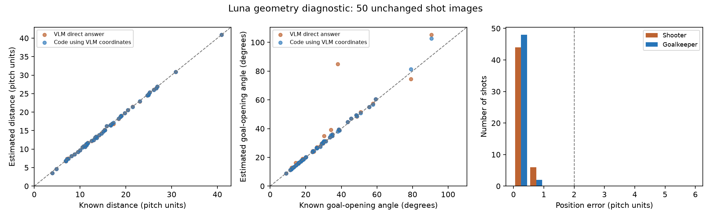
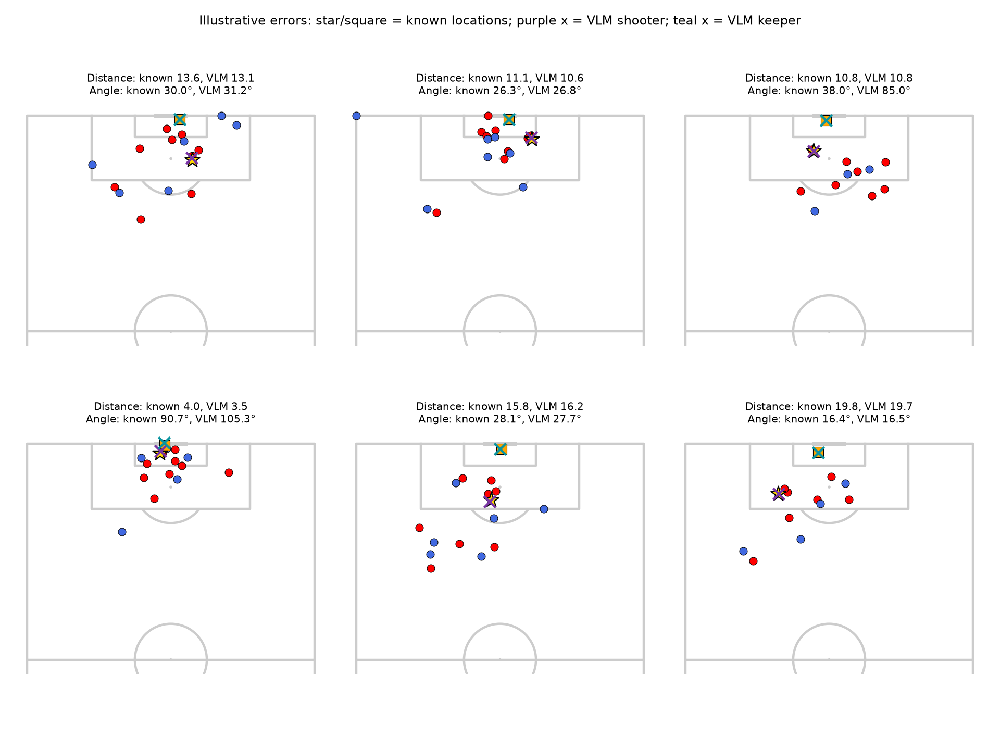

# Luna geometry diagnostic — simple report

Tested 50 randomly selected shots from the saved 300-shot run, across 37 matches. These are the unchanged benchmark images, with a new prompt asking explicitly for geometry.

| Measurement | Mean error | Median error | 90% of errors below | Within tolerance |
|---|---:|---:|---:|---:|
| Shot distance, direct answer | 0.19 pitch units | 0.14 | 0.43 | 50/50 within 2 pitch units |
| Goal-opening angle, direct answer | 1.91 degrees | 0.40 | 2.06 | 48/50 within 5 degrees |
| Shooter position | 0.23 pitch units | 0.20 | 0.51 | 50/50 within 2 pitch units |
| Goalkeeper position | 0.15 pitch units | 0.10 | 0.22 | 50/50 within 2 pitch units |
| Distance calculated from VLM coordinates | 0.18 pitch units | 0.14 | 0.45 | 50/50 within 2 pitch units |
| Angle calculated from VLM coordinates | 0.64 degrees | 0.17 | 1.17 | 49/50 within 5 degrees |

What these numbers mean:

- Luna directly estimated distance within 2 pitch units on 50/50 shots.
- It directly estimated the goal-opening angle within 5 degrees on 48/50 shots.
- It located the goalkeeper within 2 pitch units on 50/50 eligible shots.
- The coordinate-based rows use ordinary code to calculate distance and angle from Luna’s reported shooter location. They show whether calculation in code helps, without giving it the true location.

Coverage:

- Shot distance, direct answer: 50/50 eligible measurements returned.
- Goal-opening angle, direct answer: 50/50 eligible measurements returned.
- Shooter position: 50/50 eligible measurements returned.
- Goalkeeper position: 50/50 eligible measurements returned.
- Distance calculated from VLM coordinates: 50/50 eligible measurements returned.
- Angle calculated from VLM coordinates: 50/50 eligible measurements returned.

How this was tested:

- Fixed random sample, seed 7, selected by shot ID before any geometry requests. No selection by goals, xG, or model error.
- One fixed prompt, one fresh request per image, GPT-6 Luna, low reasoning, high image detail, structured JSON. Requests run sequentially.
- The model sees only the original image and fixed coordinate/angle definitions. It never receives shot coordinates, outcomes, xG, or previous answers.
- Ground truth uses the original shot location and the opposing goalkeeper in its StatsBomb shot freeze frame.
- Position error is straight-line displacement. Units match the benchmark’s normalized 120×80 StatsBomb pitch; they are not measured stadium meters or verified yards.
- Goal-opening angle is measured between the shooter-to-post lines, not the direction toward goal center.
- Tolerances of 2 pitch units and 5 degrees were fixed before requests. Unanswered eligible measurements count as failures in tolerance rates.
- Each response is saved with hashes of the image, prompt, model settings, and schema to prevent accidental mixing on resume.

Limits:

- This is an exploratory geometry diagnostic, not a new xG performance test or fine-tuning.
- An explicit geometry prompt can behave differently from the earlier xG prompt. This does not prove the cause of any earlier xG error.
- A goalkeeper coordinate can be present in the data but hard to see because markers overlap. Missing, multiple, or out-of-view keeper references are excluded from keeper position metrics and counted below.
- Reference keeper unavailable/out of view: 0/50 shots.
- Errors are descriptive for these 50 images. No thresholds or prompts were tuned after seeing the answers.





Reproduce from the repository with OPENAI_API_KEY set:

```bash
python geometry_diagnostic.py --input results/gpt_6_luna/shots.csv --n 50 --seed 7 --output results/geometry_gpt_6_luna_50
```

Sources: [OpenAI model documentation](https://developers.openai.com/api/docs/models/gpt-6-luna), [mplsoccer coordinate standardization](https://mplsoccer.readthedocs.io/en/latest/gallery/pitch_plots/plot_standardize.html).
