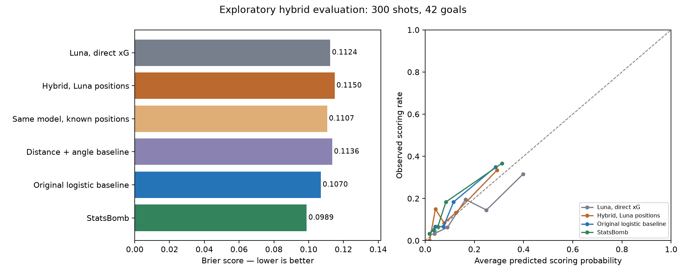

# Hybrid xG test — simple report

**The hybrid increased Brier error compared with direct Luna predictions. It did not beat the original logistic baseline by point estimate, and did not beat StatsBomb by point estimate.**

Tested the same 300 shots (42 goals; 63 matches). Observed scoring rate: 14.0%.

| Method | Brier — lower is better | AUC — higher is better | Mean predicted xG |
|---|---:|---:|---:|
| Luna, direct xG | 0.1124 | 0.728 | 18.1% |
| Hybrid, Luna positions | 0.1150 | 0.723 | 11.1% |
| Same model, known positions | 0.1107 | 0.730 | 10.5% |
| Distance + angle baseline | 0.1136 | 0.703 | 10.9% |
| Original logistic baseline | 0.1070 | 0.762 | 10.7% |
| StatsBomb | 0.0989 | 0.793 | 10.0% |

What changed:

- Luna supplies shooter and goalkeeper positions from the original images. Code computes the geometry.
- A five-feature logistic model converts geometry into a scoring probability. It uses distance, goal-opening angle, goalkeeper depth, goalkeeper distance from the shot-to-goal-center line, and whether the keeper is inside the shooting cone.
- The model receives no header/body-part feature and no defender-count feature. These were not extracted by the VLM.
- The statistical model is trained on known coordinates in the 1430-shot reference pool. For each prediction, its entire match is excluded from training. The VLM is not fine-tuned.
- The known-positions row uses the exact same fitted probability model with true geometry, to isolate the effect of image extraction.
- The distance-and-angle baseline uses only those two coordinate features, with the same training folds and preprocessing.

Uncertainty — hybrid Brier minus comparator; negative favors the hybrid:

- Luna, direct xG: +0.0026, approximate 95% match-bootstrap interval [-0.0134, +0.0196]. This includes no difference.
- Original logistic baseline: +0.0079, approximate 95% match-bootstrap interval [-0.0012, +0.0183]. This includes no difference.
- StatsBomb: +0.0161, approximate 95% match-bootstrap interval [+0.0063, +0.0271]. 
- Same model, known positions: +0.0043, approximate 95% match-bootstrap interval [+0.0002, +0.0110]. 
- Distance + angle baseline: +0.0014, approximate 95% match-bootstrap interval [-0.0075, +0.0121]. This includes no difference.

Interpretation limits:

- This is supervised statistical training plus VLM feature extraction, rather than zero-shot VLM xG.
- These are exploratory results from one competition and a repeatedly studied evaluation set. A new competition is needed for confirmation.
- The original logistic baseline receives header and opponent-count information unavailable to this hybrid; StatsBomb is a commercial reference with additional information. Those are practical comparisons, not equal-input models.
- Training uses known geometry; evaluation uses VLM measurements. That difference is deliberate and the known-positions control helps measure its cost.
- Confidence intervals resample whole matches 4,000 times, conditional on fitted cross-validation predictions; they do not include refitting uncertainty or correction for multiple comparisons.
- No parameters or feature choices were tuned after scoring this hybrid. The five-feature protocol was saved before extraction and evaluation.

