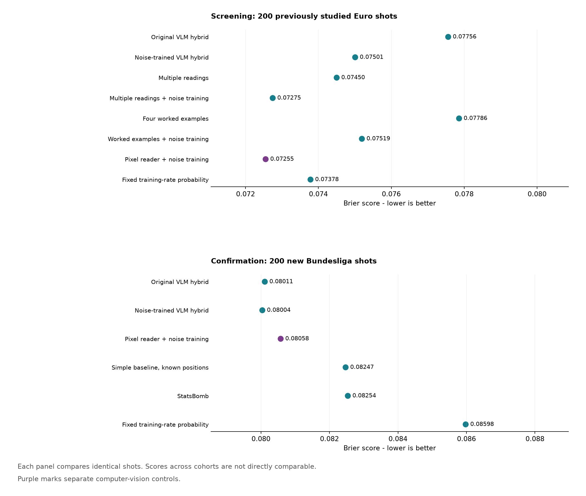
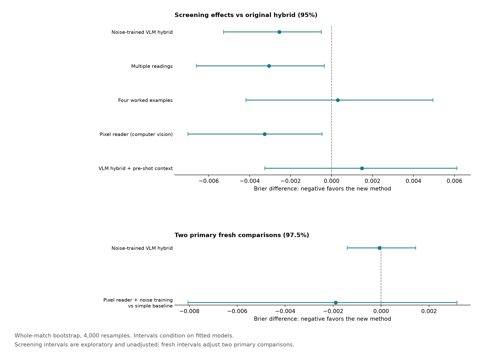

# xG research: five improvement experiments

Research date: 22 October 2026 (America/Los_Angeles).

## Findings

All five ideas were implemented and screened on 200 shots. The lowest screening Brier among the new image-only VLM pipelines was **Multiple readings + noise training: 0.07275**. The separate pixel control reached **0.07255**. These screening scores reuse the same 200 previously studied Euro 2024 shots and are not independent confirmation.

On 200 newly reserved Bundesliga shots, the primary comparison **did not establish a difference after the two-comparison adjustment**. The other primary comparison **did not establish a pixel/noise advantage over the simple baseline after adjustment**. Exact scores and adjusted intervals appear below. Pixel results are a computer-vision control; extra-context results use more information than the image-only methods.

The extra confirmation of the best screening VLM pipeline stopped at **46/200 shots because API credits ran out**. Its partial sample is not scored as a finished result.

A constant probability learned only from the training scoring rate scores **0.07378** on the Euro screen and **0.08598** on the fresh cohort. This is an important reference: improving on the logistic baseline alone does not guarantee useful image-based prediction. Its probability was fixed at 287/3,068 (9.35%) before fresh results, rather than fitted to a test scoring rate.

Brier measures probability error and is the primary score (lower is better). AUC measures how well good chances rank above poor ones (higher is better). Mean xG is the average predicted scoring rate, not an accuracy score. Log loss penalizes confident mistakes (lower is better).

## 1. Screening: same 200 Euro 2024 shots

There are 16 goals across 50 matches (8.0% scoring rate). All methods retain the same shots. World Cups 2018 and 2022 supply the 3,068 training shots, 287 goals and 128 matches. The earlier 300-shot World Cup results are preserved and are not directly compared against this different cohort.

### Image-only VLM pipelines

| Method | Brier ↓ | AUC ↑ | Mean xG | Log loss ↓ |
|---|---:|---:|---:|---:|
| Original VLM hybrid | 0.07756 | 0.675 | 9.0% | 0.27895 |
| Noise-trained VLM hybrid | 0.07501 | 0.677 | 8.5% | 0.27344 |
| Multiple readings | 0.07450 | 0.683 | 8.6% | 0.27109 |
| Multiple readings + noise training | 0.07275 | 0.687 | 8.1% | 0.26704 |
| Four worked examples | 0.07786 | 0.676 | 9.2% | 0.27991 |
| Worked examples + noise training | 0.07519 | 0.676 | 8.7% | 0.27408 |
| Simple baseline, known positions | 0.07534 | 0.669 | 8.6% | 0.27456 |
| StatsBomb | 0.07451 | 0.690 | 8.7% | 0.27001 |
| Fixed training-rate probability | 0.07378 | 0.500 | 9.4% | 0.27990 |

The practical simple baseline uses known player positions. Both VLM hybrids use measured positions only. The same-input simple baseline using Luna positions scored Brier 0.07638; the richer known-coordinate control scored 0.07297. Neither is substituted for a VLM measurement.

### Separate pixel controls

| Method | Brier ↓ | AUC ↑ | Mean xG | Log loss ↓ |
|---|---:|---:|---:|---:|
| Pixel reader (computer vision) | 0.07429 | 0.702 | 8.2% | 0.26801 |
| Pixel reader + noise training | 0.07255 | 0.705 | 7.8% | 0.26415 |
| Simple baseline, known positions | 0.07534 | 0.669 | 8.6% | 0.27456 |
| StatsBomb | 0.07451 | 0.690 | 8.7% | 0.27001 |

The pixel methods exploit the fixed diagram colors and layout. They are useful task-specific image baselines and do not demonstrate that a VLM understands football or general broadcast images.

### Extra pre-shot context

| Method | Brier ↓ | AUC ↑ | Mean xG | Log loss ↓ |
|---|---:|---:|---:|---:|
| Original VLM hybrid | 0.07756 | 0.675 | 9.0% | 0.27895 |
| VLM hybrid + pre-shot context | 0.07904 | 0.692 | 9.1% | 0.27871 |
| Noise-trained VLM hybrid | 0.07501 | 0.677 | 8.5% | 0.27344 |
| Noise training + pre-shot context | 0.07633 | 0.695 | 8.6% | 0.27214 |
| Simple baseline + same context | 0.07462 | 0.722 | 8.6% | 0.26637 |

Context increased the ranking score on the 200-shot screen but worsened Brier. It is not counted as a probability-accuracy win. The comparator with context receives the same event information. No body-part flag is added in this experiment.

### Paired screening uncertainty

| New method vs original hybrid | Brier difference [95% interval] |
|---|---:|
| Noise-trained VLM hybrid | -0.00255 [-0.00527, -0.00049] |
| Multiple readings | -0.00306 [-0.00660, -0.00035] |
| Four worked examples | +0.00030 [-0.00418, +0.00495] |
| Pixel reader (computer vision) | -0.00327 [-0.00701, -0.00047] |
| VLM hybrid + pre-shot context | +0.00148 [-0.00326, +0.00613] |

Negative differences favor the new method. These screening intervals resample entire matches and condition on fitted models. They are exploratory and unadjusted for trying several ideas or selecting the best one. Screening controls reuse older API responses; prompt conditions were not randomized in time, so service variability is another possible contributor to prompt differences.

## 2. Fresh confirmation: Bundesliga 2023/24

The fixed sample contains **200 shots, 19 goals, 34 represented matches**, with an actual scoring rate of **9.5%**. It comes from all 34 publicly available Leverkusen fixtures, including both teams' shots. This is not a full-league random sample. None of these matches trained the models or appeared in earlier Euro/World Cup analyses.

The noise-trained model, pixel algorithm, selection seed and primary comparisons were frozen before this cohort was scored. The unchanged single-panel rendering isolates model robustness from the unfinished earlier rendering revision. Original and noise-trained VLM methods share the same one-reading-per-image measurements.

| Method | Brier ↓ | AUC ↑ | Mean xG | Log loss ↓ |
|---|---:|---:|---:|---:|
| Original VLM hybrid | 0.08011 | 0.697 | 9.4% | 0.29147 |
| Noise-trained VLM hybrid | 0.08004 | 0.696 | 8.9% | 0.29193 |
| Pixel reader (computer vision) | 0.08064 | 0.696 | 9.2% | 0.29195 |
| Pixel reader + noise training | 0.08058 | 0.694 | 8.7% | 0.29225 |
| Simple baseline, known positions | 0.08247 | 0.641 | 9.2% | 0.30533 |
| Rich model, known positions | 0.08098 | 0.694 | 9.0% | 0.29305 |
| StatsBomb | 0.08254 | 0.667 | 9.5% | 0.30019 |
| Direct Luna | 0.09139 | 0.612 | 12.6% | 0.32931 |
| Fixed training-rate probability | 0.08598 | 0.500 | 9.4% | 0.31397 |

| Predeclared primary comparison | Brier difference [97.5% interval] |
|---|---:|
| Noise-trained VLM hybrid vs Original VLM hybrid | -0.00007 [-0.00141, +0.00145] |
| Pixel reader + noise training vs Simple baseline, known positions | -0.00190 [-0.00805, +0.00317] |

The two primary tests use 97.5% intervals (Bonferroni adjustment for two comparisons). Secondary 95% and 97.5% comparisons are saved in confirmation_bundesliga/comparisons.csv. The fresh sample is still small, comes from one club's fixtures and conditions intervals on already-fitted models. Results should not be generalized to every competition.

Extra-context fresh results, reported separately:

| Method | Brier ↓ | AUC ↑ | Mean xG | Log loss ↓ |
|---|---:|---:|---:|---:|
| Noise-trained VLM hybrid | 0.08004 | 0.696 | 8.9% | 0.29193 |
| Noise training + pre-shot context | 0.08157 | 0.700 | 9.4% | 0.29286 |
| Simple baseline + same context | 0.08231 | 0.682 | 9.5% | 0.29858 |

The strongest screening image-only VLM pipeline was also selected and frozen before any fresh baseline scores were released: **Multiple readings + noise training**.

**This extra confirmation is incomplete: 46/200 shots.** The API returned `credit_balance_exhausted`. Its successful readings are preserved, but no partial-cohort Brier/AUC or final intervals are reported. It is not a completed confirmation of the best screening pipeline. Resume the unchanged runner after API credits are available.

Unselected worked-example or multiple-reading variants remain screening results. The best-candidate check uses the same fresh sample; it is secondary and should not be presented as an additional independent dataset.

### Full fresh source pool: known-coordinate controls

This secondary analysis uses all **908 eligible shots, 102 goals and 34 matches** in the downloaded Leverkusen fixture pool. It includes the 200-shot VLM subset, so it is not a second independent dataset. It was added after the first 200-shot fresh scores were viewed, using already-frozen models and no additional fitting or model selection.

| Method | Brier ↓ | AUC ↑ | Mean xG | Log loss ↓ |
|---|---:|---:|---:|---:|
| Simple baseline, known positions | 0.08910 | 0.718 | 9.5% | 0.31756 |
| Rich model, known positions | 0.08535 | 0.749 | 9.9% | 0.30964 |
| Noise-trained rich model, known positions | 0.08545 | 0.753 | 9.3% | 0.30518 |
| Rich model + context, known positions | 0.08413 | 0.764 | 10.3% | 0.30246 |
| StatsBomb | 0.08256 | 0.787 | 10.4% | 0.28913 |
| Fixed training-rate probability | 0.10007 | 0.500 | 9.4% | 0.35334 |

Rich geometry minus the simple known-coordinate baseline: **-0.00375 [-0.00703, -0.00027]**, an unadjusted secondary 95% interval. This supports the statistical value of richer geometry in this pool. These measurements came from the dataset, and do not establish a VLM improvement. Commercial xG is stronger by point estimate on the full pool, despite its weaker point estimate on the small 200-shot subset.

## 3. What each experiment actually did

### Imperfect-position training

The VLM was unchanged. Each training shot became one clean and fifteen corrupted scenes. Shooter and goalkeeper residuals were sampled together from 300 saved training-only World Cup readings, preserving rare large errors. Defender jitter (0.25 pitch units) and omission probability (5%) were fixed assumptions. Geometric features were recalculated from corrupted scenes. Total weight remained one per original shot; augmentation did not create 49,088 independent observations or silently weaken the loss penalty.

Whole-match cross-validation excluded test matches from both fitting and noise donors. On simulated noisy development inputs, Brier changed from 0.07303 to 0.07272; on clean inputs it changed from 0.07190 to 0.07210. This supports a robustness tradeoff under the simulation, not a universal improvement.

### Multiple readings

Each saved original reading was paired with one new reading of the original image plus a fixed enlarged crop. A third reading was requested for more than two pitch units of disagreement, different visibility, or different defender counts: **52 of 200 shots**. Coordinates were merged using majority visibility, medians, and matched defender lists. No true query coordinates or goal outcomes entered these rules.

### Four worked examples

Four World Cup 2018 examples were selected by fixed distance strata, without using outcomes or earlier errors. Their image geometry labels precede the query image. Neither example outcomes, commercial xG nor the new shot's coordinates enter the prompt. This is few-shot prompting, not VLM fine-tuning, and it must be distinguished from the original zero-shot benchmark.

### Pixel reader

Fixed color thresholds locate gold, orange and red components. Centroids are mapped to pitch coordinates using the same renderer applied to one generic calibration scene. Forty training images checked the mapping before external scoring. Fully hidden markers cannot be recovered. The detector has knowledge of the diagram design but never reads the source coordinates for a query shot.

| Measurement condition | Mean shooter error | Shooter within 2 units | Defender count MAE | Defender recall within 2 units |
|---|---:|---:|---:|---:|
| original | 0.264 | 99.0% | 0.145 | 96.9% |
| pixels | 0.050 | 100.0% | 0.090 | 99.9% |
| multiview | 0.175 | 99.5% | 0.085 | 98.2% |
| fewshot | 0.392 | 97.0% | 0.185 | 92.6% |

Pitch units are normalized StatsBomb coordinates, not measured meters. Coverage and full per-shot measurement errors are saved in geometry_audit.csv. Measurements are diagnostic: they are not goal-prediction scores.

### Pre-shot context

The model adds shot type, play pattern, pressure and the latest earlier same-team pass in the same possession and period, at most 15 seconds before the shot. Pass features include cross, cutback, through ball, height and elapsed time. Outcomes, commercial xG, player identity and subsequent events are excluded. A one-hot/numeric context transform is fitted on training matches only.

Separate full-tournament known-coordinate controls help show the difference between context quality and noisy visual inputs:

**euro2024, 1304 shots; known-coordinate controls:**

| Method | Brier ↓ | AUC ↑ | Mean xG | Log loss ↓ |
|---|---:|---:|---:|---:|
| Rich model, known positions | 0.06424 | 0.764 | 8.6% | 0.23431 |
| Rich model + context, known positions | 0.06361 | 0.776 | 8.7% | 0.23067 |
| Simple baseline + context, known positions | 0.06437 | 0.758 | 8.7% | 0.23606 |
| StatsBomb | 0.06154 | 0.787 | 8.5% | 0.22511 |

Context minus original rich model: -0.00064 [-0.00200, +0.00069]. These reused tournament results are secondary, and the intervals include no improvement.

**euro2020, 1234 shots; known-coordinate controls:**

| Method | Brier ↓ | AUC ↑ | Mean xG | Log loss ↓ |
|---|---:|---:|---:|---:|
| Rich model, known positions | 0.07343 | 0.794 | 9.8% | 0.26271 |
| Rich model + context, known positions | 0.07264 | 0.799 | 10.1% | 0.25877 |
| Simple baseline + context, known positions | 0.07598 | 0.778 | 10.0% | 0.27089 |
| StatsBomb | 0.07030 | 0.812 | 9.7% | 0.25082 |

Context minus original rich model: -0.00079 [-0.00261, +0.00107]. These reused tournament results are secondary, and the intervals include no improvement.

### Secondary direct-probability outputs

The same requests also returned Luna's own xG. These were not used to fit the statistical heads or select geometry-consensus rules. They are secondary exploratory prompt outputs, separately reported from the image-to-geometry hybrids.

| Method | Brier ↓ | AUC ↑ | Mean xG | Log loss ↓ |
|---|---:|---:|---:|---:|
| Original position-first Luna xG | 0.07973 | 0.635 | 11.5% | 0.29074 |
| Multiple-reading direct Luna xG | 0.07916 | 0.658 | 11.7% | 0.28392 |
| Four-example direct Luna xG | 0.08684 | 0.618 | 10.7% | 0.30812 |

## 4. Validation, API usage and reproducibility

Sixteen targeted checks passed across the new experiments: split isolation, no outcomes in geometry, correct weighting of duplicate scenes, consensus alignment/visibility, no future-event context, pixel-coordinate mapping, context joins and wider multiplicity-adjusted intervals. The original hybrid reproduced saved predictions within 9.9e-17. Old protected datasets, caches and probability models were preserved.

| Request condition | Successful new requests | Input tokens | Cached input tokens | Output tokens |
|---|---:|---:|---:|---:|
| Additional full/zoom readings | 200 | 509,000 | 2,542 | 137,683 |
| Third disagreement checks | 52 | 133,640 | 0 | 39,499 |
| Four-example prompts | 200 | 1,110,200 | 0 | 119,040 |
| Fresh confirmation readings | 200 | 257,800 | 0 | 129,665 |
| Best-VLM fresh example prompts | 0 | 0 | 0 | 0 |
| Best-VLM fresh second readings | 46 | 117,070 | 2,542 | 34,316 |
| Best-VLM fresh third checks | 9 | 23,130 | 2,567 | 7,515 |

Total successful new requests: **707**. Requests ran sequentially. Cache counts do not measure unsuccessful network attempts or dollar charges. Noise training, pixel inference and statistical context fitting require no model API calls. Public StatsBomb event downloads are separate from model requests.

Artifacts include fixed protocols and hashes, saved successful responses, frozen statistical models, per-shot predictions, score tables, whole-match intervals, fold audits and public-data source hashes. The earlier clearer-image Euro 2020 run remains stopped at 62/200 responses and is not reported as a completed result.

One final worker was restarted after a stalled connection. Its successful cached responses were reused with the unchanged protocol. A preserved selection record and restart log document that the selected VLM candidate had been frozen before the first fresh scores were released.

## 5. Interpretation and practical next step

The fresh noise comparison did not establish a difference after the two-comparison adjustment; the fresh pixel comparison did not establish a pixel/noise advantage over the simple baseline after adjustment. The extra confirmation of the best screening VLM pipeline stopped at **46/200 shots because API credits ran out**. Its partial sample is not scored as a finished result. A low screening point estimate alone is not an established advantage. Multiple readings plus noise training remains the most promising tested VLM direction, and needs its prospective check completed before claiming a reliable gain.

The work separates three questions: whether images can be measured accurately, whether the statistical head tolerates measurement errors, and whether additional event context improves probabilities. AUC increases alone do not override worse Brier. Matching mean xG to the observed scoring rate is also insufficient to establish accurate individual predictions.

Further training or prompt choices should use development matches, with a new untouched confirmation set for any revised method. Preserve these negative and positive attempts rather than choosing whichever tournament or metric makes a method appear strongest.

## Sources

- [StatsBomb open data](https://github.com/statsbomb/open-data): event files and competition metadata; individual file hashes are saved.
- [Training with Noise is Equivalent to Tikhonov Regularization](https://direct.mit.edu/neco/article-pdf/7/1/108/812990/neco.1995.7.1.108.pdf): general motivation for noisy-input training; does not establish success for this xG pipeline.
- [Efficient Test-Time Scaling for Small Vision-Language Models](https://arxiv.org/abs/2510.03574): motivation for multiple augmented views; our coordinate consensus is a separate implementation.
- [Flamingo: a Visual Language Model for Few-Shot Learning](https://arxiv.org/abs/2204.14198): precedent for image examples in context; not evidence that our four-example prompt must improve.
- [Official OpenAI image-input documentation](https://developers.openai.com/api/docs/guides/images-vision?api-mode=responses): request format used for multiple images. The OpenAI Docs skill was used to check this format.
