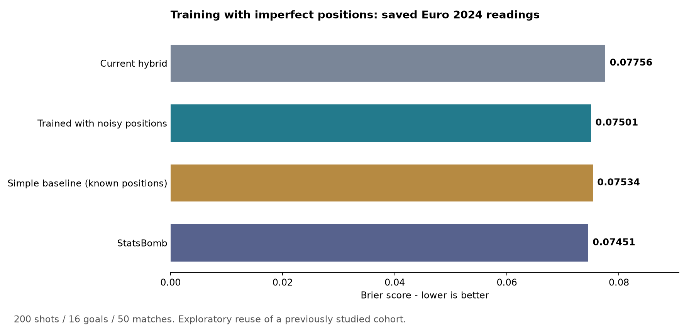

# Experiment 1: training with imperfect positions

**Brier 0.07756 -> 0.07501 (+3.29% relative reduction).** The exploratory interval favors the new model.

Paired Brier difference (new minus current): **-0.00255**, approximate 95% match-bootstrap interval **[-0.00527, -0.00049]**. Negative favors the new model.

Every method uses the same 200 Euro 2024 shots, 16 goals, and 50 matches. Actual scoring rate: 8.0%. This previously studied cohort provides an exploratory test, not independent confirmation.

| Method | Brier (lower) | AUC (higher) | Mean xG | Log loss (lower) |
|---|---:|---:|---:|---:|
| Current hybrid | 0.07756 | 0.675 | 9.0% | 0.27895 |
| Trained with noisy positions | 0.07501 | 0.677 | 8.5% | 0.27344 |
| Simple baseline (known positions) | 0.07534 | 0.669 | 8.6% | 0.27456 |
| Simple baseline (Luna positions) | 0.07638 | 0.658 | 9.0% | 0.27759 |
| Rich model (known positions) | 0.07297 | 0.697 | 8.1% | 0.26567 |
| StatsBomb | 0.07451 | 0.690 | 8.7% | 0.27001 |
| Direct Luna | 0.07973 | 0.635 | 11.5% | 0.29074 |

## What changed

Only the statistical model training inputs changed. The image-only spline model, settings, 3,068 World Cup training shots, and saved Luna readings are unchanged. Luna was not retrained.

Each training shot supplies one clean and fifteen noisy scenes. Shooter/keeper errors are sampled together from 300 World Cup readings, including rare large errors. Defenders receive 0.25-unit Gaussian coordinate noise and a 5% independent omission probability. Defender settings are fixed assumptions. Geometry is recalculated after corruption.

Every original shot retains total weight one across its sixteen copies. Augmentation adds neither independent observations nor extra total loss weight. No noise parameter or model was selected using Euro outcomes. Both VLM hybrids use extracted positions only, and all 200 test shots remain included.

## Development checks

Five folds keep complete World Cup matches together. Noise donors come only from training matches. Simulated test noise uses a separate random stream; scores below assess the simulation rather than real-world accuracy.

| Development input | Training | Brier | AUC |
|---|---|---:|---:|
| clean_positions | clean_training | 0.07190 | 0.784 |
| clean_positions | noise_training | 0.07210 | 0.784 |
| simulated_noisy_positions | clean_training | 0.07303 | 0.780 |
| simulated_noisy_positions | noise_training | 0.07272 | 0.782 |

## Limits and next decision

Training errors came from an older prompt and renderer. No measured training-defender errors were available. Synthetic noise may not reproduce occlusion or location-dependent mistakes. Euro 2024 previously informed our research; these results require fresh matches before claiming reliable improvement.

Intervals resample whole matches conditional on fitted models, omit refitting uncertainty, and are not adjusted for multiple comparisons. Known-coordinate methods are practical controls with more accurate measurements, not VLM results. The simple baseline using Luna positions shares the extracted geometry.

No new API requests were made. The partial Euro 2020 clearer-image run was not resumed. Review this result before proceeding to another proposed improvement.
