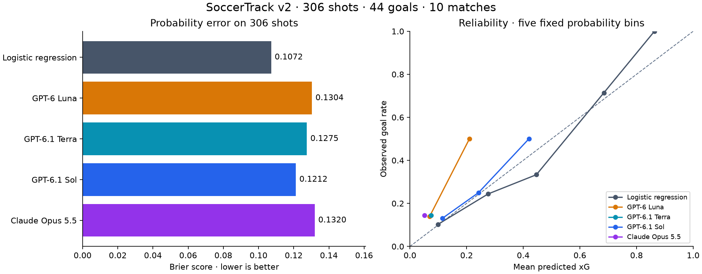

# SoccerTrack v2 model comparison

All methods were scored on the same 306 shots across ten university matches, including 44 goals. Each VLM received one panoramic frame 0.32 seconds before the shot, resized to at most 1536 px on the long side. Shooters were unmarked. The original image-only prompt assumed an average professional finisher and requested a raw probability and a one-sentence reason.

| Method | Shots | Brier ↓ | AUC ↑ | Log loss ↓ | Mean xG |
|---|---:|---:|---:|---:|---:|
| Logistic, distance + angle | 306 | 0.1072 | 0.700 | 0.3654 | 14.4% |
| Logistic, also receives header flag | 306 | 0.1044 | 0.698 | 0.3596 | 14.4% |
| Training goal-rate constant | 306 | 0.1233 | 0.445 | 0.4123 | 14.4% |
| GPT-6 Luna | 306 | 0.1304 | 0.499 | 0.4789 | 7.1% |
| GPT-6.1 Terra | 306 | 0.1275 | 0.510 | 0.4442 | 7.5% |
| GPT-6.1 Sol | 306 | 0.1212 | 0.573 | 0.4064 | 12.8% |
| Claude Opus 5.5 | 306 | 0.1320 | 0.482 | 0.4810 | 5.2% |

The main logistic regression uses shot distance and goal-opening angle from recorded coordinates. Its standardization and L2 fit exclude the complete evaluated match. The header model is a secondary comparator with additional event information.

Sol was the strongest visual model on this cohort. Logistic regression had lower probability error and better ranking. Its advantage over Luna, Terra and Opus was supported by the four-comparison-adjusted match bootstrap intervals. The Sol comparison was inconclusive. Errors were concentrated within 12 metres, where 24.3% of shots scored and every VLM had a higher Brier score than logistic regression.

## Paired Brier differences

Intervals resample whole matches 10,000 times and use 98.75% coverage for the four primary model-versus-baseline comparisons. They condition on the fitted predictions. Ten matches limit generalization.

- GPT-6 Luna minus logistic. +0.0232, interval [+0.0090, +0.0382].
- GPT-6.1 Terra minus logistic. +0.0203, interval [+0.0043, +0.0359].
- GPT-6.1 Sol minus logistic. +0.0140, interval [-0.0020, +0.0298].
- Claude Opus 5.5 minus logistic. +0.0248, interval [+0.0101, +0.0398].

## Official test matches

This subset contains 64 shots in two matches. Its logistic model is fitted on the six official training matches. It is descriptive because there are only two test matches.

| Method | Brier ↓ | AUC ↑ | Log loss ↓ | Mean xG |
|---|---:|---:|---:|---:|
| Logistic, distance + angle | 0.1191 | 0.778 | 0.3923 | 11.6% |
| GPT-6 Luna | 0.1426 | 0.514 | 0.5324 | 5.7% |
| GPT-6.1 Terra | 0.1394 | 0.567 | 0.4788 | 6.6% |
| GPT-6.1 Sol | 0.1295 | 0.601 | 0.4270 | 11.8% |
| Claude Opus 5.5 | 0.1427 | 0.612 | 0.5104 | 4.7% |

## Cost and limits

Completed 1194 new generation calls. Estimated new spending was $3.270. Conservative exposure including the prior Sol pilot was $3.939, below the $10 combined cap.

The 30 earlier Sol predictions were reused with matching image and prompt fingerprints. All probabilities remain raw. The complete cohort was already audited, and this is exploratory evaluation. BAS SHOT/GOAL labels can omit blocked or headed attempts classified under other actions, and unidentified penalties can remain. Video timing is aligned to within a few frames, the shooter is unmarked, and the panoramic view makes players small. The prompt's professional-finisher assumption differs from the university population.

Source and attribution. SoccerTrack v2 by Atom Scott, Ikuma Uchida, Kento Kuroda, Yufi Kim and Keisuke Fujii. Frames were extracted and resized under CC BY 4.0. [Dataset](https://huggingface.co/datasets/atomscott/soccertrack-v2) · [CC BY 4.0](https://creativecommons.org/licenses/by/4.0/)

## Distance groups

| Distance | Shots | Goal rate | Logistic Brier | Luna Brier | Terra Brier | Sol Brier | Opus Brier |
|---|---:|---:|---:|---:|---:|---:|---:|
| <12 m | 115 | 24.3% | 0.1581 | 0.2119 | 0.2120 | 0.1897 | 0.2210 |
| 12–18 m | 79 | 12.7% | 0.1123 | 0.1204 | 0.1139 | 0.1175 | 0.1163 |
| 18+ m | 112 | 5.4% | 0.0514 | 0.0537 | 0.0503 | 0.0535 | 0.0516 |

## New API spending

| Model | New calls | Estimated spend |
|---|---:|---:|
| GPT-6 Luna | 306 | $0.089 |
| GPT-6.1 Terra | 306 | $0.414 |
| GPT-6.1 Sol | 276 | $1.010 |
| Claude Opus 5.5 | 306 | $1.757 |

One Claude response placed extra prose before its single valid JSON answer. That original probability and usage were recovered from the saved response, with no new request or probability adjustment. The recovery is documented in parser_amendment.json and parser_reconciliation.json.
