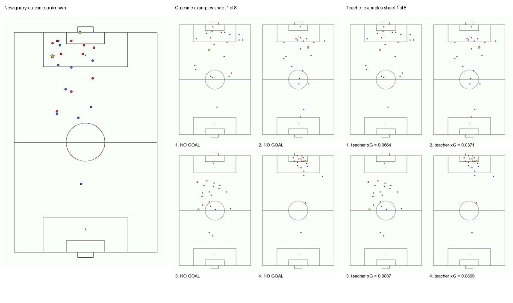

# SoccerTrack v2: player-position diagrams plus in-context learning

**Research summary — 20 November 2026, Pacific time. Completed and audited.**

Tested whether in-context examples add value to the annotation-assisted pitch diagrams that improved the preceding photograph comparison. **In-context learning means providing labelled examples in the model's request while keeping its weights unchanged.** Here, each new diagram was accompanied by 32 other-match diagrams labelled either with observed goal/no-goal outcomes or with probabilities from a spatial logistic teacher. Both mechanisms have matched shuffled-label controls.

**Observed-outcome examples** does not establish a Brier improvement over no-example diagrams.

**Spatial-teacher examples** does not establish a Brier improvement over no-example diagrams.

## Matched results

All rows use the **same 304 shots, 43 goals and 10 matches**. Actual goal rate: **14.14%**. Lower Brier/log loss are better; higher AUC indicates better ranking. The model is **Claude Sonnet 5.5, low effort**, for every new visual condition.

| Method | Brier ↓ | AUC ↑ | Log loss ↓ | Mean xG |
| --- | ---: | ---: | ---: | ---: |
| Diagram, no examples (fresh) | 0.114746 | 0.7056 | 0.3867 | 8.92% |
| Diagram + 32 observed-outcome examples | 0.118721 | 0.6812 | 0.4025 | 8.17% |
| Diagram + shuffled outcome labels | 0.119527 | 0.6640 | 0.4072 | 8.14% |
| Diagram + 32 spatial-teacher examples | 0.115156 | 0.6842 | 0.3861 | 10.80% |
| Diagram + shuffled teacher labels | 0.117306 | 0.6700 | 0.3933 | 10.17% |
| Original photograph (previous run, matched shots) | 0.129295 | 0.5991 | 0.4617 | 5.07% |
| Diagram, no examples (previous run, matched shots) | 0.114825 | 0.7061 | 0.3870 | 8.88% |
| Photograph + diagram (previous run, matched shots) | 0.116126 | 0.7066 | 0.3896 | 8.14% |
| Pre-shot distance/angle logistic | 0.111399 | 0.6607 | 0.3783 | 14.12% |
| Pre-shot spatial logistic | 0.108780 | 0.7104 | 0.3668 | 14.24% |
| Other matches' training goal rate | 0.121539 | 0.4535 | 0.4080 | 14.16% |

The first five rows are the newly generated matched comparison. The three historical image references reuse saved predictions on the identical shots; they are descriptive and were not regenerated or averaged with the new outputs. The fresh no-example diagram requests have exactly the same image bytes, prompt, model and settings as their historical diagram counterparts, so differences also illustrate generation variability. The two logistic models use complete-query-match exclusions, pre-shot timing and training-only scaling. The spatial model receives the same six geometric features used by the teacher.

In this completed run, the fresh no-example diagram condition has the lowest Brier point estimate among the five new visual conditions. Outcome examples worsen both Brier and AUC point estimates. Teacher examples move mean xG closer to the observed rate (10.80% versus 8.92% without examples, against 14.14% observed), but do not lower Brier and reduce AUC from 0.7056 to 0.6842. Every primary interval below includes zero: neither improvement over diagrams alone nor an advantage over the corresponding shuffled control is established. The fresh no-example Brier (0.114746) is close to the preceding diagram score (0.114825); this is a descriptive consistency observation, not an equivalence test.

The teacher is a fitted logistic model, not a source of ground-truth xG. Its lower or higher point Brier cannot by itself establish that a VLM imitates it successfully or beats it reliably. No VLM-versus-logistic significance test was prespecified. No predicted probability was recalibrated, blended, averaged or replaced by a statistical output.

## Four prespecified comparisons

Differences are the first method's Brier minus the second method's Brier; negative favors the first. Each interval resamples complete matches with paired predictions, 20,000 draws and 98.75% confidence. The four intervals use Bonferroni adjustment for a nominal 5% family error rate.

| Prespecified comparison | Brier difference | 98.75% match interval |
| --- | ---: | --- |
| Diagram + 32 observed-outcome examples minus Diagram, no examples (fresh) | +0.003974 | [-0.001341, +0.010460] |
| Diagram + 32 observed-outcome examples minus Diagram + shuffled outcome labels | -0.000807 | [-0.004513, +0.002585] |
| Diagram + 32 spatial-teacher examples minus Diagram, no examples (fresh) | +0.000410 | [-0.003663, +0.004650] |
| Diagram + 32 spatial-teacher examples minus Diagram + shuffled teacher labels | -0.002150 | [-0.007233, +0.002170] |

Beating the no-example condition assesses improvement from the complete ICL intervention. Beating the corresponding shuffled-label control additionally tests whether correct diagram/label associations matter beyond the label distribution and example presentation. A point gain or a lower mean prediction alone does not establish either claim. Intervals include only ten match groups and condition on the fitted teacher models and selected example sets; overlapping other-match fits are not refitted within bootstrap draws.

## Inputs and learning mechanisms

- **Query:** the unchanged 640×960 pre-shot player-position diagram from the preceding spatial study. Gold star identifies the shooter; blue circles teammates, red circles opponents and orange square the opposing goalkeeper. The attacking goal is at the top. The source frame is approximately 0.32 seconds before the event.
- **Outcome32:** 32 natural random diagrams from the other nine matches, paired with their single observed GOAL or NO GOAL outcome. The prompt explicitly explains that binary results are noisy observations, not true probabilities.
- **Shuffled outcome32:** the identical images in the identical order, with the outcome labels permuted while preserving the number of goals.
- **Teacher32:** the same 32 diagrams, paired with four-decimal teacher probabilities. The teacher is a ridge-1 logistic model using pre-shot distance, angle, goalkeeper distance from the goal line, keeper lateral error, defenders in the shooting triangle and nearest defender distance. Its coefficients and scaling exclude the query's entire match. Its probabilities on the training examples serve as labels; the query's teacher probability is never supplied.
- **Shuffled teacher32:** the identical example images and order, with the complete rounded teacher-value distribution permuted.
- **No examples:** a fresh prediction using only the query diagram and the preceding spatial study's unchanged prompt.

Each match has a fixed, seeded set of 32 examples, without goal balancing or outcome-driven example selection. Goal counts by excluded query match: **117092: 3, 117093: 2, 118575: 5, 118576: 3, 118577: 3, 118578: 4, 128057: 4, 128058: 4, 132831: 5, 132877: 6**. None of these sets contains only one class. A query's entire match is excluded from both its examples and teacher fitting; other matches can appear in different evaluation folds, as in cross-validation.

Example diagrams are resized to 320×480 and placed four per 640×1008 JPEG sheet, with 17-pixel labels. Eight sheets precede the separate full-size query. They are smaller than the query but retain explicit shooter and team/keeper markers. No photographs, post-shot frames, auxiliary interpolated ball track, query outcomes, body-part labels, numeric coordinates, player names, reference xG or query teacher probabilities appear in new requests. Teacher examples are explicitly distinguished from observed-outcome learning.

The illustration uses the first source shot ID in sorted order, independent of prediction quality or outcome. It shows one sheet from each mechanism; actual ICL requests include all eight sheets. The model's weights and low-effort settings remain unchanged, with structured JSON output and a 1,024-token maximum.

## Budget-defined cohort and execution

The maximum pool was the preceding study's 304 source-eligible shots. A seeded natural random order within matches, interleaved across a seeded match order, defined the only allowable prefix. Before any accuracy scoring, the frozen rule reserved the **maximum uncached or five-minute-cache-write input cost plus maximum output cost for every request in a complete five-condition block**. At each step, the largest next block of up to ten complete shots was allowed only if its full reservation fit the remaining $10. No incomplete shot was started just to use the remaining balance. Cache savings could extend the prefix but could not change the conditions, examples or order.

Terminal result: **full_pool_completed**, with **304 complete paired shots**. The final cohort was determined by usage and the predeclared stopping rule, not by looking at accuracy. This is a resource-selected exploratory cohort rather than a fixed-N independent trial. No method, prompt, example count or later expansion was chosen using these scores.

Explicit five-minute caching applies only to the final historical-example sheet and its prefix. It does not cache query answers as demonstrations or carry previous query responses into later requests. Each request has one independent user message. Caching changes computation reuse and cost, not the intended input content.

**1,520 successful generation requests**, zero failed, retried or uncertain requests. New estimated spending: **$6.317800**; conservative accounting: **$7.448312**, under the **$10 incremental experiment cap**. Previous completed studies' charges are separate. No paid runner remains active. These are usage-based estimates, not a live provider invoice.

Recorded tokens: 1,844,368 ordinary input; 283,440 cache writes; 8,333,136 cache reads; 108,715 output. Current model rates were verified against [official model documentation](https://platform.claude.com/docs/en/models/sonnet-5-5/overview): $2/M ordinary input, $2.50/M five-minute writes, $0.10/M reads and $10/M output. Conservative completed accounting charges ordinary input at $2.50/M and reads at $0.125/M, retains $2.50/M writes and $10/M output, and reserves pending requests at the full uncached/write bound. Savings are counted only after the provider returns usage. One-hour caching is disabled.

## Verification and limits

The final audit passed **33 checks**, reconstructing every one of the **1,520 request hashes and raw responses**, all **320 example sheets**, exact source-image hashes, complete-match teacher exclusions, fixed label permutations, the paired prefix and block reservations, token bounds, scores, adjusted intervals and spending. Seven financial checks and two full-budget simulations also passed, including a run with no cache hits. The new audit inherits the preceding frozen 21-check source audit; it does not claim to have downloaded or verified complete large annotation files.

The released positions, roles, actor identity, camera resources and pre-shot diagrams remain **annotation-assisted**. The earlier geometry exclusions remain: 118576_2_41455 and 128057_2_46854 had the shooter at or beyond the goal line, leaving 304 shots and 43 goals from the initial 306 shots and 44 goals. Small camera files were fully hash-verified in the source study; the large GSR files were retrieved as validated ranges. Whole large-file SHA256 verification is not claimed. The current ICL requests reuse diagrams rather than re-running camera projection or automatic detection.

All ten university matches were studied previously. This is exploratory match-held-out evaluation, not untouched external confirmation. Supplied annotations may involve offline reconstruction and do not prove a causal real-time tracking pipeline. The professional-finisher assumption remains a mismatch with university footage, and the source event selection can omit blocked/header attempts assigned other event classes. Natural example outcomes are noisy; teacher labels inherit model assumptions and training error. Example and training sets overlap across folds. Conclusions apply to this model, representation, example count and cohort; they do not establish that all forms of ICL help or fail.

## Saved outputs

- [Per-shot probabilities](predictions.csv)
- [Scores, intervals, usage and terminal result](summary.json)
- [Frozen protocol and dependency hashes](protocol.json)
- [Final audit](audit.json)
- [Example identities and labels](examples.json)
- [Complete-block reservation ledger](blocks.json)
- [Code and reproduction notes](../../experiments/soccertrack_spatial_icl/README.md)
- [Preceding spatial-information experiment](../soccertrack_spatial_v1/REPORT.md)

SoccerTrack v2 by Atom Scott, Ikuma Uchida, Kento Kuroda, Yufi Kim and Keisuke Fujii. [Official dataset](https://huggingface.co/datasets/atomscott/soccertrack-v2), [CC BY 4.0](https://creativecommons.org/licenses/by/4.0/). Example sheets and diagrams are derived from the dataset's released annotations. Source attribution and retrieval provenance are retained in the preceding experiment.
