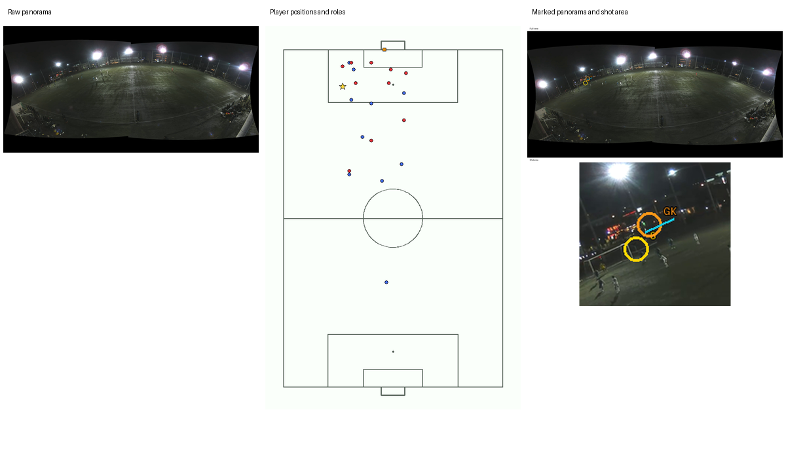

# SoccerTrack v2: using player positions, roles and calibration for xG

**Research summary — 20 November 2026, Pacific time. Completed and audited.**

Converting the released player positions and roles into pitch diagrams improved direct VLM predictions compared with the same model viewing the original panoramic photographs. Diagram Brier fell from **0.1293 to 0.1148**, an **11.2% relative reduction**, and AUC rose from **0.599 to 0.706**. The prespecified, multiplicity-adjusted match bootstrap interval supports the Brier improvement in this exploratory cohort. Marking and enlarging the photograph did not establish a benefit. Statistical models still achieved lower Brier point estimates.

This is an **annotation-assisted information-value experiment**: it uses the dataset's released positions, roles, image boxes and shooter identity. It does not demonstrate an automatic player detector or a complete deployment pipeline. All ten matches were studied previously, so this is not untouched external confirmation.

## Matched results

All rows below use the **same 304 shots, 43 goals and 10 university matches**. Lower Brier and log loss are better; higher AUC indicates better shot ranking. The observed goal rate was **14.14%**.

| Method | Brier ↓ | AUC ↑ | Log loss ↓ | Mean xG |
| --- | ---: | ---: | ---: | ---: |
| Sonnet 5.5: original photograph | 0.129295 | 0.5991 | 0.4617 | 5.07% |
| Sonnet 5.5: positions and roles diagram | **0.114825** | 0.7061 | **0.3870** | 8.88% |
| Sonnet 5.5: marked full photograph and enlarged shot area | 0.133462 | 0.6247 | 0.4795 | 5.75% |
| Sonnet 5.5: original photograph plus diagram | 0.116126 | 0.7066 | 0.3896 | 8.14% |
| Logistic: pre-shot distance and angle | 0.111399 | 0.6607 | 0.3783 | 14.12% |
| Logistic: pre-shot distance, angle and spatial features | 0.108780 | 0.7104 | 0.3668 | 14.24% |
| Constant: other matches' training goal rate | 0.121539 | 0.4535 | 0.4080 | 14.16% |
| Logistic reference: at-event distance and angle | 0.107648 | 0.6932 | 0.3664 | 14.18% |
| Logistic reference: at-event distance, angle and header | 0.104574 | 0.6927 | 0.3601 | 14.12% |

The two at-event references are descriptive comparisons using later geometry; the header reference also receives explicit body-part information unavailable to the visual conditions. They were refitted on the same eligible shots with complete-match exclusions. They are not the primary test of additional pre-shot spatial features.

The diagram still underpredicts the overall goal rate: mean xG is 8.88% against 14.14% observed. Adding the photograph to the diagram did not further reduce the Brier point estimate. A direct diagram-versus-combination superiority or equivalence test was not prespecified. No VLM probabilities were recalibrated, blended, averaged or replaced by fitted probabilities.

## Prespecified comparisons

Each difference is the first method's Brier minus the second method's Brier; negative favors the first method. Intervals resample complete matches, preserving paired predictions, with 20,000 draws. Each interval is **98.75%**, using Bonferroni adjustment across the four primary comparisons for a nominal 5% family error rate.

| Comparison | Brier difference | 98.75% match interval | Interpretation |
| --- | ---: | --- | --- |
| Diagram minus original photograph | -0.014470 | [-0.031512, -0.001253] | Supports improvement in this cohort |
| Marked photograph/crop minus original photograph | +0.004167 | [-0.002848, +0.011558] | No supported benefit |
| Photograph plus diagram minus original photograph | -0.013170 | [-0.024985, -0.002607] | Supports improvement in this cohort |
| Spatial logistic minus basic pre-shot logistic | -0.002620 | [-0.005545, +0.000917] | Small point gain; interval includes zero |

There are only ten match groups. These percentile intervals are conditional on the saved predictions and fitted models; the overlapping other-match logistic fits are held fixed during resampling. They do not capture every source of training, annotation or model-generation uncertainty. No primary interval comparing the VLM against logistic regression was declared, so the lower logistic Brier values are point comparisons rather than new significance claims.

## What the model received

**Model:** `claude-sonnet-5-5`, low effort, global inference, structured JSON output, at most 1,024 output tokens. One raw prediction per shot per visual condition; unchanged weights, no ICL, no output calibration. A fresh photograph control was generated with the same model, prompt and settings as the new inputs. These absolute scores should not be compared directly with earlier Sol ICL results, which used a different model and cohort.

The same prompt explains every representation and asks for the scoring probability for an average professional finisher. Inputs show the exact archived photograph approximately **0.32 seconds before the event**. Body part, ball height and preceding motion are described as unknown. The professional-finisher assumption remains a mismatch with university footage.

1. **Original photograph:** unchanged archived panoramic PNG; no added shooter or goalkeeper marker.
2. **Diagram:** a 640×960 full-pitch view from released pre-shot player coordinates. The attacking goal is at the top. A gold star identifies the shooter, blue circles teammates, red circles opponents and an orange square the opposing goalkeeper. No outcome, body-part label, numeric shot coordinate, player name, reference xG or event ID appears in the image.
3. **Marked photograph and crop:** released image boxes locate the shooter and opposing keeper; yellow S and orange GK markers identify them. Camera calibration projects a cyan goal-mouth line. A composite contains the full marked view above an enlarged region retaining the shooter, keeper, goal and defenders in the shooting cone, with margins. Enlargement adds no source detail.
4. **Photograph plus diagram:** the original photograph and diagram supplied as two images in one request.

The preview uses the first source shot ID in sorted order, chosen without examining its prediction quality or outcome. It is an illustration, not an additional model condition. The diagram intervention combines cleaner geometry, explicit shooter identity and role/team markers; this study does not isolate the contribution of each component or of camera calibration alone.

The statistical comparison uses L2 logistic regression with ridge 1 and training-only standardization. Each evaluated shot's **entire match** is excluded from coefficient fitting and scaling. The basic model receives pre-shot distance to goal center and angle between the posts. The spatial model adds goalkeeper distance from the goal line, lateral displacement from the shooter-to-goal-center line, number of outfield opponents inside the shooting triangle and nearest outfield opponent distance. Both use identical matches and timing. No hyperparameters were selected on these results.

## Source retrieval and alignment

The existing local GSR files were Git LFS pointers. Actual frame records were retrieved selectively from the author's officially linked public SoccerTrack v2 mirror, rather than downloading every multi-gigabyte annotation file. Original pointers and previous results were preserved.

- Recovered **612 exact snapshots**: pre-shot input and at-event alignment-audit snapshots for each of the original 306 shots across 20 match halves. Model inputs use only the pre-shot snapshot. The auxiliary interpolated ball track was excluded because it can depend on later event anchors.
- Enforced GSR's one-based frame suffix: annotation suffix equals decoded video frame index plus one. The selected snapshot corresponds to the saved pre-shot image, eight frames before the event under the source indexing convention.
- Parsed roles and team membership from the actual nested attributes, matched the shooter through the source event actor ID, required an opposing goalkeeper and at least 18 valid player/keeper coordinates, and checked attack direction against opposing-keeper position.
- Used the canonical 105×68 m field, center-origin positions and team-side direction. Two source shots had the tracked shooter at or beyond the attacking goal line: `118576_2_41455` and `128057_2_46854`. Both were excluded before generation, leaving 304 shots and 43 goals from the original 306 shots and 44 goals. No shot was excluded because of prediction quality.
- Retrieved the full small homography and camera-intrinsic resources for all ten matches, verifying **all 20 SHA256 values** against canonical local LFS pointers. Loaded only numeric arrays with `allow_pickle=False`; object arrays were never unpickled.
- Reprojected field points using the author's homography and fisheye camera transform. Large map arrays contributed only their NPY shape headers for original image dimensions; the full displacement maps were not used.

Each retrieved byte range has a recorded SHA256 and validated HTTP 206 Content-Range and file size. Saved snapshots reconstruct from complete annotation groups inside those cached ranges. **The complete large annotation files were not downloaded, so their full-file SHA256 values were not independently verified.** Do not equate range integrity with complete-file verification.

The median across shots of median player projection-to-released-image-box error was **5.83 original-source pixels**. This is an internal consistency measure, not independent calibration or detection accuracy: the released boxes and pitch coordinates are not an independent validation set.

## Alignment sensitivity

At-event source locations and the tracked shooter's at-contact position disagreed by a median **1.60 m**. Nineteen shots exceeded 5 m. They remained in the primary analysis; the frozen protocol separately requested a score-only sensitivity analysis excluding them, without refitting or changing predictions.

The resulting subset contains **285 shots and 41 goals**:

| Method | Brier ↓ | AUC ↑ |
| --- | ---: | ---: |
| Original photograph | 0.131484 | 0.5865 |
| Diagram | 0.115822 | 0.7137 |
| Marked photograph/crop | 0.135591 | 0.6188 |
| Photograph plus diagram | 0.118167 | 0.7048 |
| Pre-shot basic logistic | 0.112632 | 0.6620 |
| Pre-shot spatial logistic | 0.108143 | 0.7165 |
| At-event geometry logistic reference | 0.109753 | 0.6883 |
| At-event geometry/header logistic reference | 0.106233 | 0.6864 |

The main directions persist. This is a descriptive sensitivity check, not a second independent trial or an additional significance claim.

## Spending and verification

**1,216 successful generation requests**, four per eligible shot. No failed, retried or uncertain generation requests. Estimated spending was **$5.525214**; conservative usage accounting was **$6.683825**, below the **$10 cap for this experiment**. These are recorded usage estimates rather than a live provider bill. No paid runner remains active.

The cohort, input hashes, implementation, four visual conditions, primary contrasts and budget rule were frozen before generation. A usage-only token forecast allowed all 304 eligible shots; no smaller cohort or method was selected by accuracy. Cyclic condition order balances dispatch order. The final offline audit passed **21 checks**, including all 612 reconstructed snapshots, 20 camera-file hashes, 1,216 exact request payloads and responses, probability bounds, costs, role/actor extraction, complete-match fitting exclusions and frozen artifact hashes. Mutating query outcome, header and at-event geometry leaves the rendered input pixels unchanged.

## Interpretation and next experiment

The released spatial information is useful when presented as a clear pitch diagram. This provides a concrete improvement over this model's panoramic-image control, while identifying a negative result for the marked/cropped presentation. It does not establish that role information alone, calibration alone or every VLM will improve, and it does not establish superiority to statistical xG.

The next useful confirmation would freeze the diagram method and evaluate different matches, ideally with more independent match groups. A subsequent paired test could compare released positions with automatically detected/projected positions on those matches to measure how much of this gain survives realistic detection and calibration errors. Neither further paid stage was started here.

## Files and attribution

- [Machine-readable results and intervals](summary.json)
- [Per-shot predictions](predictions.csv)
- [Frozen protocol](protocol.json)
- [Final audit](audit.json)
- [Code and reproduction notes](../../experiments/soccertrack_spatial/README.md)

SoccerTrack v2 by Atom Scott, Ikuma Uchida, Kento Kuroda, Yufi Kim and Keisuke Fujii. Source: [official dataset](https://huggingface.co/datasets/atomscott/soccertrack-v2), distributed under [CC BY 4.0](https://creativecommons.org/licenses/by/4.0/). The image preview, diagrams and marked crops are derived from that dataset. The original source material, snapshot provenance and author projection reference are retained with the experiment.
