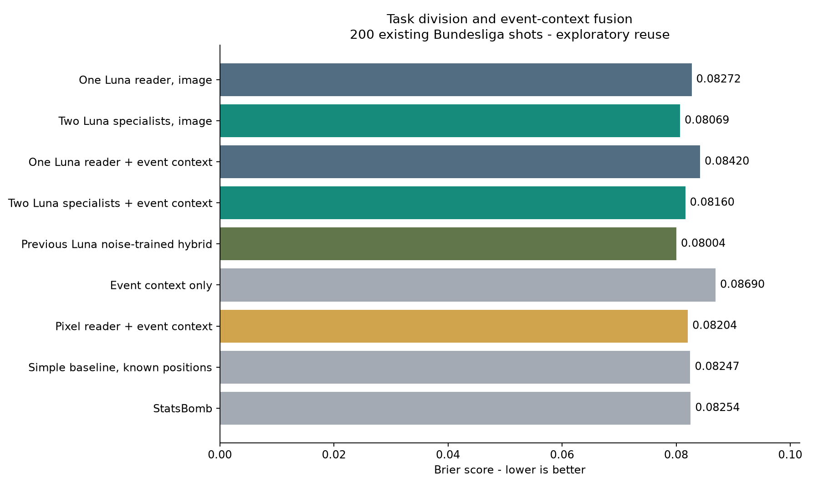

# Luna task division and multimodal fusion

Research date: 23 October 2026 (America/Los_Angeles).

Completed **200 shots, 19 goals, 34 matches**, using **600 successful Luna requests**. Only gpt-6-luna was requested. No new dataset was downloaded.

## Main findings

- Two Luna specialists, image versus One Luna reader, image: Brier difference **-0.00204**, adjusted 97.5% interval **[-0.00706, +0.00068]**; does not establish a difference.
- Two Luna specialists + event context versus One Luna reader + event context: Brier difference **-0.00259**, adjusted 97.5% interval **[-0.00831, +0.00042]**; does not establish a difference.

The previous noise-trained Luna pipeline scored Brier **0.08004**, compared with **0.08069** for the specialists. Task division therefore does not improve the previous pipeline by point estimate; the new monolithic control is a different geometry-only prompt.

Adding saved event context to the specialist pipeline produced higher Brier by 0.00092; secondary 95% interval [-0.00260, +0.00416]. This comparison changes from the frozen image head to the frozen context head and is not a primary task-division test.

Negative paired differences favor the first method. The two primary intervals adjust for two comparisons. All results reuse a previously studied sample and remain exploratory.

## Probability results

| Method | Brier - lower | AUC - higher | Log loss - lower | Mean xG |
|---|---:|---:|---:|---:|
| One Luna reader, image | 0.08272 | 0.676 | 0.29963 | 9.2% |
| Two Luna specialists, image | 0.08069 | 0.688 | 0.29379 | 8.9% |
| One Luna reader + event context | 0.08420 | 0.685 | 0.30073 | 9.7% |
| Two Luna specialists + event context | 0.08160 | 0.696 | 0.29336 | 9.4% |
| Event context only | 0.08690 | 0.652 | 0.30862 | 10.3% |
| Fixed training scoring rate | 0.08598 | 0.500 | 0.31397 | 9.4% |
| Previous Luna noise-trained hybrid | 0.08004 | 0.696 | 0.29193 | 8.9% |
| Pixel reader, image | 0.08058 | 0.694 | 0.29225 | 8.7% |
| Pixel reader + event context | 0.08204 | 0.698 | 0.29360 | 9.2% |
| Known positions, image features | 0.08099 | 0.690 | 0.29372 | 8.5% |
| Known positions + event context | 0.08221 | 0.699 | 0.29419 | 9.1% |
| Simple baseline, known positions | 0.08247 | 0.641 | 0.30533 | 9.2% |
| StatsBomb | 0.08254 | 0.667 | 0.30019 | 9.5% |

Every method retains the same 200 shots. Brier and log loss measure probability error; lower is better. AUC measures ranking; higher is better. Mean xG is not accuracy.

## Division of work

1. A shooter/goalkeeper Luna specialist reads those two markers.
2. A separate defender Luna specialist reads the visible red defender markers.
3. Code concatenates these measurements and computes geometry.
4. Frozen supervised probability heads score geometry alone or geometry plus saved event context.

A new single-reader geometry-only Luna control reads all markers in one call. All roles receive the identical original diagram, shared geometry instructions and model settings. None estimates xG. Role order is randomized within each shot, and readers never see one another's answers.

The multimodal condition is late fusion of image-derived measurements and structured event metadata. It does not add video, inferred body pose, a VLM judge, VLM fine-tuning or different underlying VLM models.

## Context and fitting

The nine context variables are shot type, play pattern, under pressure, existence of a recent pass, cross/cutback/through-ball flags, pass height, and seconds since that pass. The pass must precede the shot, come from the same team in the same possession and period, and be within 15 seconds. No body part, shot outcome, placement or commercial xG enters a predictor.

The image and context probability heads were already trained and frozen on 3,068 World Cup shots (287 goals). The metadata-only logistic baseline uses those same training matches and context transform, C=0.3, without search. The metadata-only baseline fits original training rows, while the frozen fusion head used weighted augmented rows; their rare-category grouping can differ. It is a practical reference, not an identical-preprocessing ablation. The constant reference is the fixed training scoring rate. No evaluation labels fit a model, calibrator or selection rule.

Pixel and known-position controls receive the same context and fitted heads. Known positions are diagnostic controls and never replace a VLM measurement. Missing visual measurements use frozen training imputation; no shots are dropped. Saved prior Luna/context/pixel control predictions reproduce to numerical precision.

## Paired uncertainty

| First minus second | Brier difference | Interval |
|---|---:|---:|
| Two Luna specialists, image minus One Luna reader, image | -0.00204 | 97.5%: [-0.00706, +0.00068] |
| Two Luna specialists + event context minus One Luna reader + event context | -0.00259 | 97.5%: [-0.00831, +0.00042] |
| Two Luna specialists + event context minus Two Luna specialists, image | +0.00092 | 95.0%: [-0.00260, +0.00416] |
| One Luna reader + event context minus One Luna reader, image | +0.00147 | 95.0%: [-0.00217, +0.00493] |
| Two Luna specialists + event context minus Event context only | -0.00530 | 95.0%: [-0.01828, +0.00570] |
| Two Luna specialists + event context minus Pixel reader + event context | -0.00044 | 95.0%: [-0.00257, +0.00147] |
| Two Luna specialists, image minus Previous Luna noise-trained hybrid | +0.00065 | 95.0%: [-0.00061, +0.00195] |
| Two Luna specialists + event context minus StatsBomb | -0.00093 | 95.0%: [-0.00833, +0.00601] |
| Two Luna specialists + event context minus Simple baseline, known positions | -0.00087 | 95.0%: [-0.00740, +0.00513] |
| Two Luna specialists, image minus Known positions, image features | -0.00030 | 95.0%: [-0.00328, +0.00217] |

Whole matches are resampled 4,000 times with a fixed seed. The two primary comparisons use 97.5% Bonferroni intervals. Other 95% comparisons are secondary and unadjusted for multiplicity. Intervals condition on fitted models and omit refitting uncertainty.

## Measurement audit

| Reader | Shooter mean error | Keeper mean error | Defender count MAE | Defender recall within 2 units |
|---|---:|---:|---:|---:|
| monolithic | 0.234 | 0.069 | 0.080 | 98.1% |
| specialists | 0.131 | 0.064 | 0.095 | 98.2% |
| previous | 0.219 | 0.104 | 0.095 | 98.4% |
| pixels | 0.051 | 0.042 | 0.090 | 99.9% |

Errors use normalized pitch units, not meters. The audit follows inference and cannot alter prompts or predictions. Per-shot errors, coverage and defender precision are saved separately. Fully hidden markers cannot reliably be recovered.

## Cost, provenance and checks

Total successful-response usage: 729,200 input tokens and 223,630 output tokens. Per-role counts and elapsed times are in usage.csv; these are not exact billing or failed-attempt counts.

Specialists use two calls per shot versus one for the new monolithic control. This is a practical task-division comparison, not equal inference cost. Time order is randomized within shots; service variability and older saved comparison outputs remain limitations.

Returned models: gpt-6-luna. Existing protected inputs were unchanged; training/test matches are disjoint. The protocol fixes prompts, schemas, code/input/image hashes and request schedule before new inference. Responses are individually saved and validated for exact resumption. No partial cohort is scored.

Eight targeted tests cover the Luna restriction, response validation, outcome-blind request payloads, missingness, deterministic fusion, cache provenance, protected inputs and uncertainty. An integration replay with saved readings separately exercises the full 200-shot evaluator without paid requests.

## Interpretation limits

This is a supervised hybrid study rather than the original zero-shot xG benchmark. The sample contains only 19 goals and comes from 34 Leverkusen fixtures, not a full-league random sample. It has already been studied; new API readings do not make it an untouched confirmation set. Positive results require later reserved matches. An interval crossing zero does not prove equivalence.

Sources: [StatsBomb open data](https://github.com/hudl/open-data), [OpenAI image inputs](https://developers.openai.com/api/docs/guides/images-vision?api-mode=responses), [OpenAI structured outputs](https://developers.openai.com/api/docs/guides/structured-outputs?api-mode=responses).
